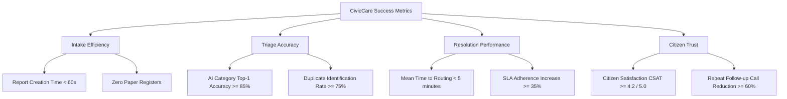
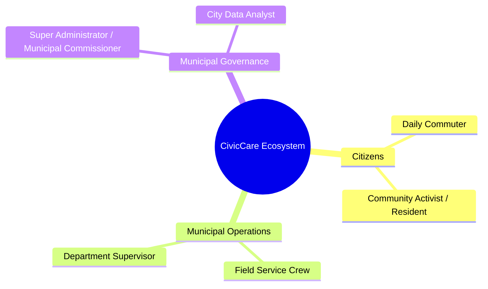
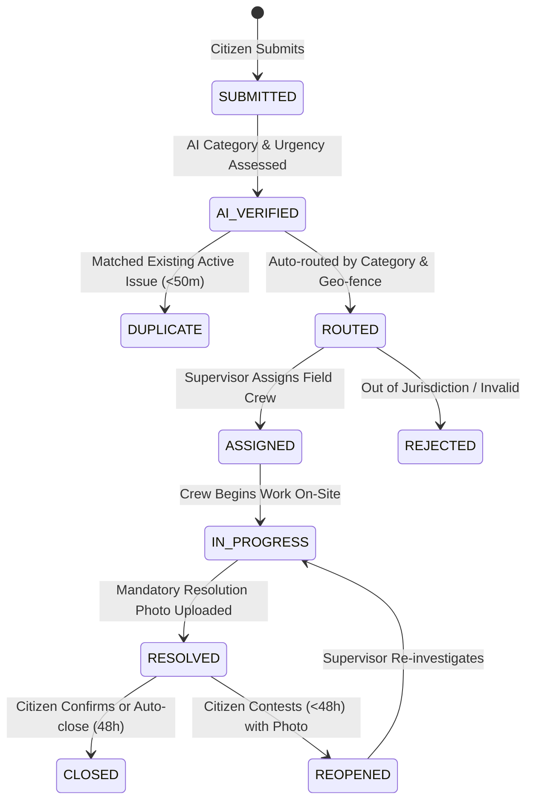

# Document 01 — Product Requirements Document (PRD)
## CivicCare: AI-Based Crowdsourced Civic Issue Reporting, Classification, and Resolution System

---

### 1. Document Control & Metadata
- **Document Identifier:** CIVIC-PRD-001
- **Status:** Approved for Implementation Architecture
- **Version:** 1.0.0
- **Author:** Product Engineering & Architecture Guild
- **Source Artifacts:** 
  - Presentation: `Civic_Issue_Reporting_System_Modules_After_Proposed_System.pptx` (Slides 1–9)
  - UI Baseline: `image.png` (Screens 1–9 + Report Details Drawer)

---

### 2. Product Vision & Overview

#### 2.1 Executive Statement
CivicCare is an intelligent, transparent, and crowdsourced municipal governance ecosystem designed to dismantle the barriers between city residents and municipal administrative bodies. By combining mobile-first digital reporting, on-device and edge artificial intelligence (computer vision and natural language processing), spatial-temporal deduplication, and automated ticket dispatching, CivicCare transforms chaotic civic complaints into structured, verifiable, and trackable municipal tasks.

#### 2.2 Core Value Proposition
- **For Citizens:** A friction-free 60-second incident reporting experience with visual validation, automated location detection, complete progress visibility, and closure accountability.
- **For Municipal Departments:** Elimination of manual categorization backlogs, automated routing of specialized tickets directly to relevant engineering departments, automated detection of duplicate complaints for the same road or pipe, and tamper-resistant photographic resolution proof.
- **For City Administrators:** Macro-level visibility into municipal infrastructure degradation, geographic heatmaps of civic failures, departmental SLA performance metrics, and predictive insights for urban capital budgeting.

---

### 3. Problem Statement & Root Cause Analysis

Based on Slide 3 of the source presentation, current municipal grievance mechanisms across urban jurisdictions suffer from structural flaws:

| Problem Domain | Root Cause in Legacy Systems | Impact on Stakeholders |
| :--- | :--- | :--- |
| **No Standard Reporting Channel** | Fragmentation across manual paper registers, call centers, email inboxes, and unstructured social media mentions. | Complaints are lost, unacknowledged, or delayed by weeks before intake. |
| **Manual Categorization** | Non-technical intake operators manually read, interpret, and triage raw descriptions. | High rate of ticket misrouting (e.g., stormwater drainage routed to water supply), causing back-and-forth delays. |
| **Zero Citizen Visibility** | Citizens receive no tracking reference or periodic status updates following complaint intake. | Citizen disillusionment, eroded public trust, and repeated phone calls to helplines querying status. |
| **Duplicate & Unverified Reports** | A single pothole on a busy road generates 50 distinct complaints filed by 50 different commuters. | Departmental queues are clogged with redundant tickets; field crews visit the exact same location multiple times. |
| **Lack of Prioritization** | All complaints are processed in a first-in, first-out (FIFO) queue regardless of actual hazard level. | Critical safety emergencies (e.g., uncovered manholes, fallen live electrical wires) sit behind minor cosmetic grievances. |
| **Disconnected Departments** | Siloed municipal departments operate independent legacy tracking sheets with no unified dispatch protocol. | Inter-departmental disputes over asset ownership (e.g., road surface vs. underground utility line repairs). |

---

### 4. Objectives & Measurable Success Criteria

#### 4.1 Primary Objectives
1. **Intake Unification:** Consolidate all citizen complaints into a single digital intake funnel accessible via mobile applications.
2. **Automated AI Triage:** Leverage computer vision to classify issue categories and assess hazard severity within seconds of submission.
3. **Redundancy Suppression:** Detect and cluster spatial-temporal duplicate reports within a 50-meter radius, linking citizen notifications to a single master ticket.
4. **Smart Dispatch:** Route complaints directly to the appropriate municipal department using category mapping and administrative boundary geofencing.
5. **Auditable Resolution:** Enforce mandatory photographic resolution evidence uploaded by field workers before any ticket can be marked as resolved.

#### 4.2 Key Performance Indicators (KPIs) & Success Metrics



| Metric Identifier | Description | Baseline (Legacy) | CivicCare Target (MVP) | Target (Post-Launch 6M) |
| :--- | :--- | :--- | :--- | :--- |
| **MET-001** | Average time for citizen to lodge a complaint | 15–45 minutes | < 60 seconds | < 45 seconds |
| **MET-002** | Time from submission to department assignment | 24–72 hours | < 5 minutes (automated) | Near real-time (< 60s) |
| **MET-003** | AI Category Classification Top-1 Accuracy | N/A (Manual: 65%) | $\ge 82\%$ on standard categories | $\ge 90\%$ after retraining |
| **MET-004** | Duplicate Ticket Clustering Precision | 0% (All logged) | $\ge 75\%$ within 50m / 14 days | $\ge 88\%$ with image vector match |
| **MET-005** | Resolution cycle time for Critical/High hazards | 7–14 days | < 48 hours | < 24 hours |
| **MET-006** | Citizen resolution re-opening / dispute rate | Unknown | < 8% of closed tickets | < 4% of closed tickets |

---

### 5. Target User Personas & Ecosystem Stakeholders



#### Persona 1: Rajesh Sharma — Daily Commuter & Resident (Citizen)
- **Demographics:** Age 34, software engineer, daily two-wheeler commuter in Mumbai.
- **Goals:** Quickly report hazardous potholes and open drains encountered during daily transit without filling lengthy bureaucratic forms.
- **Pain Points:** Encountered the same dangerous pothole on MG Road for two months; previously called municipal helpline three times without receiving any complaint tracking number or response.
- **Tech Proficiency:** High; uses smartphone for banking, navigation, and ride-hailing daily.

#### Persona 2: Sunita Patil — Senior Sanitation Supervisor (Department Supervisor)
- **Demographics:** Age 48, Supervisor at Solid Waste Management Department, Ward K-West.
- **Goals:** Monitor garbage accumulation across 24 municipal beats, assign clearance trucks effectively, and ensure team clears overflowing bins before public complaints escalate.
- **Pain Points:** Swamped with 100+ daily complaints, 40% of which are duplicates for the same roadside bin; struggles to verify whether field drivers actually emptied the dumpster.
- **Tech Proficiency:** Moderate; comfortable with web dashboards and tablets.

#### Persona 3: Ramesh Kamble — Field Maintenance Worker (Field Staff)
- **Demographics:** Age 39, Road Maintenance asphalt repair crew lead.
- **Goals:** Receive clear, geocoded daily repair lists with exact site photos, complete repairs, and confirm closure without tedious manual paperwork.
- **Pain Points:** Dispatched to vague text locations (e.g., "near temple, main road") only to find the road already repaired or located in a different jurisdiction.
- **Tech Proficiency:** Basic; uses WhatsApp and voice messaging on Android smartphones.

#### Persona 4: Vikram Deshmukh — Municipal Commissioner / Super Admin
- **Demographics:** Age 52, IAS Officer overseeing City Municipal Corporation.
- **Goals:** Real-time visibility into infrastructure health, departmental accountability, SLA breaches, and data-backed allocation of road resurfacing contracts.
- **Pain Points:** Dependent on monthly departmental summary reports that hide delayed resolutions and lack geographic context.
- **Tech Proficiency:** Moderate to High; relies on executive KPI dashboards and analytical reports.

---

### 6. Product Scope & Functional Requirements

The system requirements are categorized into distinct functional modules:
- Module 1: Citizen Mobile Application & Reporting
- Module 2: AI Computer Vision & Classification Engine
- Module 3: Spatial-Temporal Duplicate Detection
- Module 4: Department Smart Routing & Work Orders
- Module 5: Municipal Admin & Department Web Dashboard
- Module 6: Tracking, Notifications & Audit Logging

#### 6.1 Citizen Mobile Application Requirements

| Requirement ID | Module / Feature | Detailed Functional Description | Priority |
| :--- | :--- | :--- | :--- |
| **FR-001** | Authentication | Citizen can register and sign in using mobile number (SMS OTP) or Email / Social Auth. | P0 (MVP) |
| **FR-002** | User Profile | Citizen can view and manage basic profile details (Name, Contact Number, Preferred Language). | P1 |
| **FR-003** | Onboarding Flow | Multi-step interactive introductory walkthrough explaining photo capture, GPS tagging, and tracking. | P1 |
| **FR-004** | Home Dashboard | Display user location context, quick action "Report an Issue" button, category shortcuts, and nearby reports. | P0 (MVP) |
| **FR-005** | Camera Capture | Launch in-app camera or media gallery to photograph civic issues with EXIF timestamp and orientation validation. | P0 (MVP) |
| **FR-006** | Multi-Image Support | Citizen can upload 1 primary photo and up to 2 supplementary photos showing context or angle. | P1 |
| **FR-007** | Automated GPS Capture | Automatically fetch high-accuracy GPS coordinates (latitude, longitude, horizontal accuracy) via device hardware. | P0 (MVP) |
| **FR-008** | Manual Location Refinement | Interactive mini-map allowing user to drag the pin or search reverse-geocoded street addresses if GPS drifted. | P0 (MVP) |
| **FR-009** | Text Description Intake | Text area supporting up to 300 characters describing specific failure conditions or landmarks. | P0 (MVP) |
| **FR-010** | Pre-Submission AI Review | Display real-time AI classification preview, detected category, and estimated hazard rating before final submission. | P0 (MVP) |
| **FR-011** | User Category Override | Citizen can override AI-predicted category if the computer vision model misidentified the object. | P0 (MVP) |
| **FR-012** | Duplicate Alert Modal | Prompt citizen when existing complaints are detected within 50 meters, offering option to "Upvote Existing" or "Submit Anyway". | P0 (MVP) |
| **FR-013** | Submission Confirmation | Display human-readable Report Tracking ID (e.g., `#CC20241026`), copy button, summary, and action links. | P0 (MVP) |
| **FR-014** | Personal Report History | "My Reports" screen listing active, in-progress, and resolved complaints filed by the authenticated citizen. | P0 (MVP) |
| **FR-015** | Live Progress Timeline | Detailed report tracking view displaying chronological milestone steps (Submitted $\rightarrow$ AI Verified $\rightarrow$ Routed $\rightarrow$ In Progress $\rightarrow$ Resolved). | P0 (MVP) |
| **FR-016** | Nearby Issues Map | Interactive map rendering active civic reports within a 5 km radius, filtered by category and status. | P1 |
| **FR-017** | Push Notifications | Real-time push alerts on report status transitions (assigned, crew dispatched, resolved). | P1 |
| **FR-018** | Citizen Feedback & Rating | Citizen can rate resolution quality (1 to 5 stars), submit text feedback, or dispute closure within 48 hours. | P1 |

#### 6.2 AI Classification & Inference Pipeline Requirements

| Requirement ID | Module / Feature | Detailed Functional Description | Priority |
| :--- | :--- | :--- | :--- |
| **FR-019** | Image Preprocessing | Automatically resize, normalize, check image blur/exposure, and convert uploaded photos to model tensor shapes. | P0 (MVP) |
| **FR-020** | Multi-Class Object Detection | Computer vision model (fine-tuned YOLOv8) identifying civic issues: Pothole, Garbage, Streetlight, Water Leak, Broken Road. | P0 (MVP) |
| **FR-021** | Bounding Box Generation | Output normalized bounding coordinates $(x_{min}, y_{min}, x_{max}, y_{max})$ and confidence scores $(0.0 - 1.0)$. | P1 |
| **FR-022** | NLP Description Analysis | NLP pipeline extracting semantic entities, verifying relevance, and classifying secondary intent from description text. | P1 |
| **FR-023** | Severity Estimation | Heuristic scoring combining detected object size, bounding box area, description keywords (e.g., "sparking", "deep"), and road tier. | P1 |
| **FR-024** | Low-Confidence Fallback | If top category confidence $< 0.60$, mark classification as `UNCERTAIN`, default to `OTHERS`, and flag for human supervisor review. | P0 (MVP) |
| **FR-025** | Spatial-Temporal Deduplication | Query active reports within 50m radius logged in past 14 days; compute image vector cosine similarity; return match candidates. | P0 (MVP) |

#### 6.3 Municipal Admin & Department Web Dashboard Requirements

| Requirement ID | Module / Feature | Detailed Functional Description | Priority |
| :--- | :--- | :--- | :--- |
| **FR-026** | Role-Based Access Control | Secure authentication supporting Super Admin, Department Supervisor, and Municipal Staff roles with distinct permissions. | P0 (MVP) |
| **FR-027** | Executive KPI Overview | Dashboard overview displaying Total Reports, Pending, In Progress, Resolved, monthly growth deltas, and category share. | P0 (MVP) |
| **FR-028** | Realtime Report Feed | Data table displaying incoming complaints with thumbnail, ID, title, category badge, severity indicator, location, and status. | P0 (MVP) |
| **FR-029** | Multi-Criteria Filtering | Filter report queues by date range, municipal department, ward, category, severity rating, and workflow status. | P0 (MVP) |
| **FR-030** | Interactive Geospatial Map | Full-screen map interface plotting geocoded incident pins, color-coded by severity, with clustering and clickable detail popups. | P0 (MVP) |
| **FR-031** | Report Inspection Drawer | Slide-over drawer displaying high-resolution photographs, AI bounding boxes, citizen description, GPS location, and timeline. | P0 (MVP) |
| **FR-032** | Department Reassignment | Supervisor can reassign misclassified or multi-departmental complaints to another municipal department with mandatory audit remarks. | P0 (MVP) |
| **FR-033** | Field Staff Assignment | Supervisor can delegate ticket to a specific field maintenance engineer or work crew with scheduled completion deadline. | P0 (MVP) |
| **FR-034** | Workflow Status Updates | Authorized personnel can transition status from `ROUTED` $\rightarrow$ `IN_PROGRESS` $\rightarrow$ `RESOLVED` with mandatory status commentary. | P0 (MVP) |
| **FR-035** | Photographic Resolution Evidence | System requires uploading at least 1 verified post-repair photograph before a ticket can be transitioned to `RESOLVED`. | P0 (MVP) |
| **FR-036** | Duplicate Merging | Admin can link suspected duplicate tickets as secondary children to a primary master incident ticket. | P1 |
| **FR-037** | Department Analytics | Visual analytics displaying resolution velocity, SLA compliance rates, repeat hotspots, and department leaderboards. | P1 |
| **FR-038** | Immutable Audit Trail | Automatic logging of every status modification, department transfer, reassignment, and remark with timestamp and user ID. | P0 (MVP) |

---

### 7. Non-Functional Requirements (NFR)

#### 7.1 Performance Requirements
- **NFR-001 (API Latency):** 95th percentile ($p95$) latency for standard database read/write queries must not exceed $250\text{ ms}$.
- **NFR-002 (AI Inference Throughput):** Image preprocessing and deep learning classification per ticket must complete within $2.5\text{ seconds}$ on dedicated CPU/GPU infrastructure.
- **NFR-003 (Mobile App Cold Start):** Application cold start time must be under $2.0\text{ seconds}$ on mid-tier Android devices (e.g., 4GB RAM).
- **NFR-004 (Map Render Performance):** Interactive map view must render up to 1,000 spatial pins smoothly using vector tile clustering at 60 FPS.

#### 7.2 Scalability & Availability
- **NFR-005 (Concurrency):** System backend must support 500 concurrent active citizen sessions and up to 10,000 daily report submissions during peak monsoon/disaster periods.
- **NFR-006 (High Availability):** Application APIs and database layers must maintain $99.9\%$ operational uptime excluding scheduled off-peak maintenance.
- **NFR-007 (Elastic Media Storage):** Media storage must scale elastically to support 500,000+ compressed image artifacts (approx. 250 GB) per year without degradation.

#### 7.3 Security & Data Protection
- **NFR-008 (Transport Encryption):** All network communications must be enforced over TLS 1.3 with Strict Transport Security (HSTS).
- **NFR-009 (Storage Isolation):** Report photographs must be stored in private cloud storage buckets accessible only via time-limited signed URLs (TTL $\le 15$ minutes).
- **NFR-010 (EXIF Stripping):** All sensitive EXIF metadata (device serial numbers, private home coordinates from photo library) must be sanitized upon upload.
- **NFR-011 (Row-Level Security):** PostgreSQL Row-Level Security (RLS) must prevent any citizen from updating ticket statuses, accessing internal municipal remarks, or viewing other citizens' unredacted personal profiles.

#### 7.4 Usability & Accessibility
- **NFR-012 (WCAG Compliance):** Web dashboard and mobile application must meet WCAG 2.1 Level AA standards for color contrast, screen reader compatibility, and touch target sizes ($\ge 44 \times 44\text{ pt}$).
- **NFR-013 (Offline Resiliency):** Mobile app must cache pending report drafts locally in SQLite/AsyncStorage when cellular data is lost, auto-syncing upon reconnection.

---

### 8. User Stories & Acceptance Criteria

#### US-001: Mobile Incident Reporting with AI Assistance
- **As a** Citizen commuter,
- **I want to** snap a photo of a dangerous road pothole, have the app automatically detect location and category, and submit it,
- **So that** the municipal corporation can quickly repair it before accidents occur.

```gherkin
Scenario: Successful photo capture and automated classification
  Given the citizen is authenticated and on the Home Screen
  When the citizen taps "Report an Issue"
  And captures a clear photograph of an asphalt pothole
  Then the app captures device GPS coordinates with accuracy <= 15 meters
  And the AI analysis screen displays "Pothole" with confidence >= 0.85
  And the pre-filled category selector displays "Pothole"
  When the citizen enters "Deep pothole near signal" and taps "Submit Report"
  Then the system generates ticket ID "#CC20241026"
  And displays the Report Submitted confirmation screen with a "Track This Report" button.
```

#### US-002: Spatial Duplicate Detection & Suppression
- **As a** Municipal Administrator,
- **I want** the system to alert citizens when another resident has already reported the exact same issue nearby,
- **So that** our department queue is not overwhelmed with 40 identical tickets for one pothole.

```gherkin
Scenario: Citizen submits a duplicate complaint within 50 meters
  Given an active ticket #CC20241010 exists for "Pothole on 5th Avenue" at lat: 19.1136, lng: 72.8697
  When a second citizen attempts to submit a report within 35 meters for category "Pothole"
  Then the application displays a Duplicate Warning Modal
  And shows thumbnail and details of ticket #CC20241010
  When the citizen selects "Upvote / Follow Existing"
  Then the citizen's user ID is added as a subscriber to #CC20241010
  And no duplicate database record is created in the primary dispatch queue.
```

#### US-003: Department Work Order Resolution Proof
- **As a** Department Supervisor,
- **I want** to require field workers to upload a photographic proof of the finished repair before closing a ticket,
- **So that** contractors cannot falsely claim work was completed without actual physical repair.

```gherkin
Scenario: Field staff attempts to resolve a ticket without evidence
  Given an assigned ticket #CC20241026 is currently "In Progress"
  When the supervisor attempts to transition status to "Resolved" without attaching an image
  Then the system rejects the update with error "Resolution photo proof is mandatory"
  When the supervisor attaches a post-repair asphalt repair photograph and submits
  Then the ticket status transitions to "Resolved"
  And an automated push notification is sent to the reporting citizen.
```

---

### 9. Business Rules & Operational Policies



- **BR-001 (Category to Department Mapping):**
  - `POTHOLE`, `BROKEN_ROAD` $\rightarrow$ Road Maintenance Department / Public Works.
  - `GARBAGE` $\rightarrow$ Solid Waste Management Department.
  - `STREETLIGHT` $\rightarrow$ Electrical & Public Lighting Department.
  - `WATER_LEAK` $\rightarrow$ Water Supply & Sewerage Department.
  - `OTHERS` $\rightarrow$ General Civic Grievance Triage Cell.
- **BR-002 (Duplicate Window):** Reports within $\le 50\text{ meters}$ and logged within the preceding 14 days sharing the same category are classified as duplicate candidates.
- **BR-003 (Mandatory Resolution Evidence):** No ticket may transition from `IN_PROGRESS` to `RESOLVED` without at least one valid image uploaded as `resolution_evidence`.
- **BR-004 (Resolution Dispute Window):** Citizens have 48 hours following a `RESOLVED` status notification to tap "Dispute / Reopen". If no dispute is filed within 48 hours, the ticket transitions to `CLOSED`.
- **BR-005 (Immutability of Audit Trails):** Once created, audit log entries cannot be modified or deleted by any user role, including Super Admins.

---

### 10. Scope Boundaries: MVP vs. Future Scope

| Feature / Capability | MVP Scope (Phase 1–8) | Post-MVP / Future Scope |
| :--- | :---: | :---: |
| Citizen Auth (Email, Mobile OTP) | **Included** | — |
| Single & Multi-Photo Capture | **Included** | — |
| GPS Hardware Geocoding & Reverse Address | **Included** | — |
| AI Category Prediction (YOLOv8 5 Classes) | **Included** | — |
| Citizen Category Override Option | **Included** | — |
| PostGIS Spatial Radius Deduplication | **Included** | — |
| Auto-routing to 5 Core Municipal Departments | **Included** | — |
| Citizen Status Tracking Timeline | **Included** | — |
| Admin Web Dashboard (KPIs, Table, Map View) | **Included** | — |
| Resolution Photo Upload Enforcement | **Included** | — |
| Basic Push & Email Notifications | **Included** | — |
| AI Image Vector Cosine Deduplication (CLIP) | Planned Phase 7 | Full Real-time Inference |
| Deepfake / AI Generated Image Detection | Excluded | Future Scope (Requires Custom Dataset) |
| Live Continuous Camera Feed Object Detection | Excluded | Future Scope (Device Battery/Compute Drain) |
| Multilingual Speech-to-Text & Regional Chatbot | Excluded | Future Scope (Slide 8 Roadmap) |
| Automated Drone / Street Camera Ingestion | Excluded | Enterprise Smart City Integration |

---

### 11. Assumptions, Constraints & Dependencies

#### 11.1 Assumptions
1. Citizens possess standard Android or iOS smartphones with functional camera hardware and GPS location services enabled.
2. Municipal corporations maintain defined jurisdictional polygons (GeoJSON boundaries) separating wards and maintenance beats.
3. Network connectivity is available during incident submission, or temporary device storage is available for offline queueing.

#### 11.2 Constraints
1. **Camera Quality Variations:** Citizen photos may suffer from motion blur, low night-time lighting, or dirty lenses, requiring low-confidence human fallbacks.
2. **GPS Precision Limitations:** Urban canyons and high-rise clusters may degrade smartphone GPS horizontal accuracy from 5m up to 35m.
3. **Cloud Resource Limits:** Free-tier limits on Supabase and hosting providers necessitate aggressive image compression (JPEG 80%, max 1600px dimension).

#### 11.3 Dependencies
- **Expo Framework (v51+):** Mobile camera, location, filesystem, and notification APIs.
- **Supabase Cloud:** Managed PostgreSQL, PostGIS spatial queries, and S3-compatible Object Storage.
- **Ultralytics / PyTorch:** Computer vision inference runtime for YOLOv8 model weights.
- **OpenStreetMap / Mapbox:** Vector tile rendering and reverse-geocoding APIs.

---

### 12. Definition of Done (DoD)

A requirement or user story is formally considered **Done** only when:
1. **Code Complete:** Code is written in TypeScript/Python, strictly typed with zero compiler or linter errors.
2. **Unit Tested:** Unit test coverage $\ge 80\%$ for core business logic, validation schemas, and database triggers.
3. **Integration Verified:** End-to-end integration verified from mobile client $\rightarrow$ API Gateway $\rightarrow$ AI Service $\rightarrow$ Supabase Database.
4. **Security Audited:** All database operations validated against Row-Level Security policies; no API keys or service tokens exposed in client bundles.
5. **UI Reviewed:** Mobile and Web screens match visual specifications in `image.png` with responsive behavior across target viewports.
6. **Documentation Updated:** Corresponding API routes, schemas, and test cases documented across Documents 02 through 15.

---
*Next Document: [Document 02 — System Workflow and User Journeys](file:///d:/SOURCE%20CODE/BUSINESS/CIVIC%20CARE/docs/02_SYSTEM_WORKFLOWS_AND_USER_JOURNEYS.md)*
