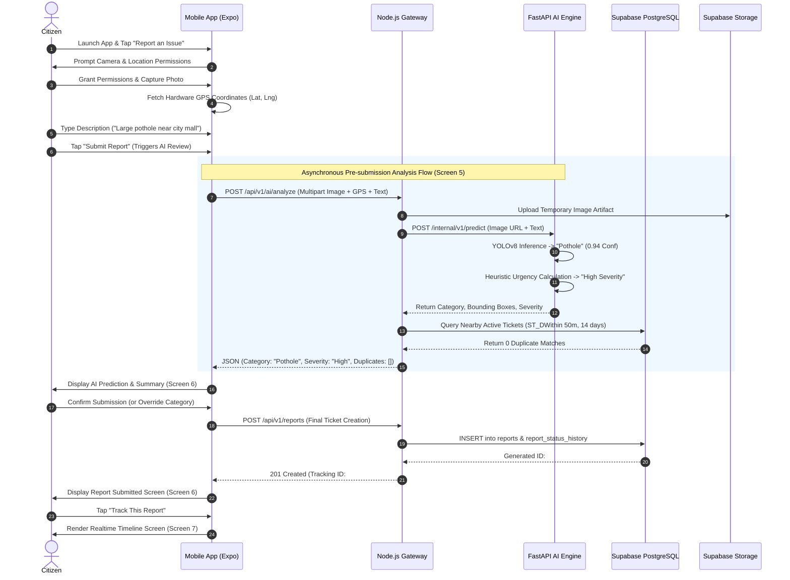
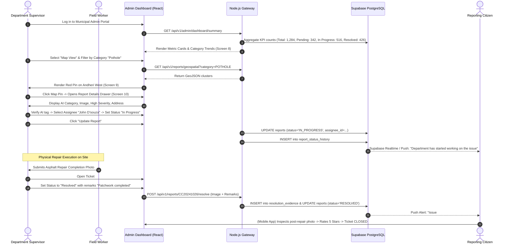
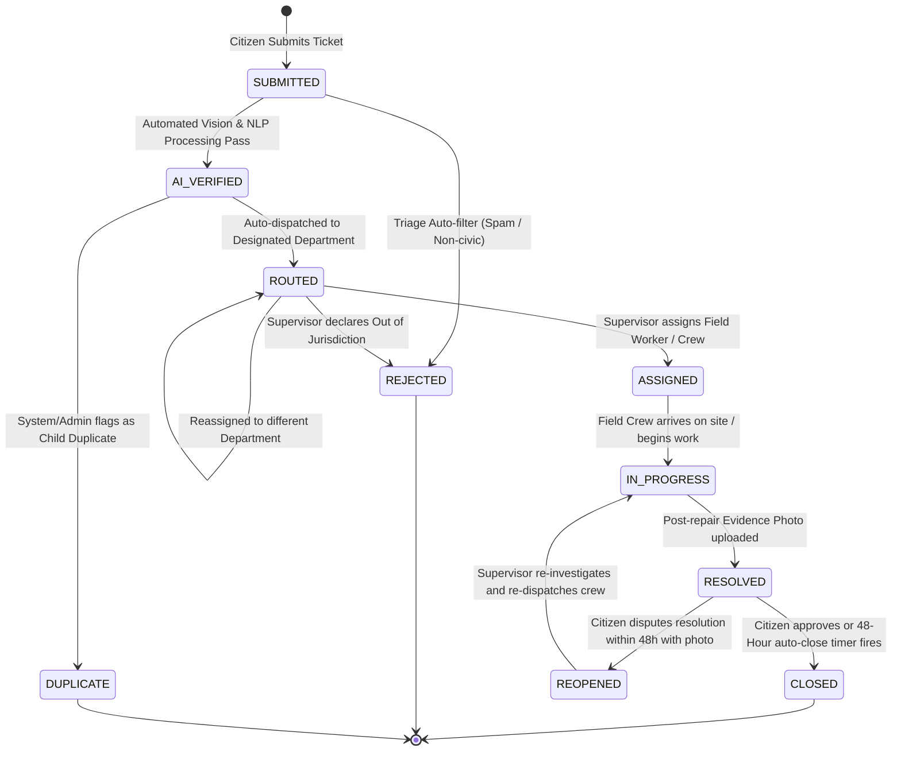

# Document 02 — System Workflow and User Journeys
## CivicCare: End-to-End Incident Lifecycle, State Machines, and Interaction Flows

---

### 1. Document Control & Metadata
- **Document Identifier:** CIVIC-SYS-002
- **Status:** Approved for Implementation Architecture
- **Version:** 1.0.0
- **Primary Source References:**
  - Presentation: `Civic_Issue_Reporting_System_Modules_After_Proposed_System.pptx` (Slides 2, 5, 6, 7)
  - UI Baseline: `image.png` (Screens 1–7 Citizen Lifecycle; Screens 8–9 Admin Workflow)

---

### 2. High-Level System Architecture & Flow Comparison

To validate the value proposition established in Slide 5 (Existing System) vs. Slide 7 (Proposed System), the end-to-end journey transitions from an error-prone manual paper funnel into an automated, transparent, and auditable pipeline.

```mermaid
graph TD
    subgraph "Legacy System (Slide 5) — High Friction & Opaque"
        A1[Citizen visits office or calls helpline] --> B1[Manual entry into paper register]
        B1 --> C1[Intake clerk manually guesses category]
        C1 --> D1[Physical paper memo forwarded to department]
        D1 --> E1[No tracking number; ticket frequently lost]
    end

    subgraph "CivicCare Proposed System (Slide 7) — Intelligent & Transparent"
        A2[Citizen captures photo + GPS + text in app] --> B2[AI Service: YOLOv8 Computer Vision + NLP]
        B2 --> C2[Spatial Deduplication: PostGIS 50m Cluster]
        C2 --> D2[Automated Smart Routing to Municipal Dept]
        D2 --> E2[Real-time Timeline Tracking, Push Alerts & Audit Proof]
    end

    style A1 fill:#ffebee,stroke:#c62828,stroke-width:1px
    style E1 fill:#ffebee,stroke:#c62828,stroke-width:1px
    style A2 fill:#e8f5e9,stroke:#2e7d32,stroke-width:1px
    style E2 fill:#e8f5e9,stroke:#2e7d32,stroke-width:1px
```



---

### 3. Citizen User Journey & Step-by-Step Experience

The citizen reporting lifecycle represents the core intake engine of CivicCare, spanning Screens 1 through 7 of `image.png`.



#### Detailed Phase Breakdown:
1. **Intake Initialization (Screens 1–3):** 
   - Citizen launches app; if unauthenticated, guided through Splash/Onboarding or Login.
   - Home screen displays localized greeting, contextual weather/city banner, recent issues in current ward, and primary blue action button: `[+] Report an Issue`.
2. **Evidence Collection (Screen 4):**
   - Citizen clicks camera icon; native hardware captures image at full sensor resolution.
   - GPS hardware service samples coordinates continuously until horizontal accuracy is $\le 15$ meters.
   - Reverse-geocoding translates latitude/longitude into human-readable street string (e.g., `"MG Road, Andheri West, Mumbai, Maharashtra"`).
   - Citizen writes concise description (up to 300 characters).
3. **AI Analysis & Pre-Check (Screen 5):**
   - App renders dynamic analysis checklist with micro-animations:
     - `[✓] Image analysis`
     - `[✓] Text analysis`
     - `[⟳] Detecting category`
     - `[○] Estimating severity`
     - `[○] Finding similar reports`
4. **Duplicate Warning Intervention (Screen 5/6 Branch):**
   - If an existing open complaint is located within 50 meters with matching category, the Duplicate Alert Modal appears showing the existing photo and timestamp.
   - Citizen can choose to **"Upvote & Follow"** (increments subscriber count on existing ticket, preventing clutter) or **"Submit Anyway"** (creates independent ticket if citizen insists this is a separate distinct issue).
5. **Confirmation & Tracking (Screens 6–7):**
   - Confirmation displays ticket badge `#CC20241026`, detected category (`Pothole`), severity (`High`), and auto-detected street address.
   - Live Tracking screen subscribes via Supabase Realtime to instant state changes.

---

### 4. Municipal Administrator & Department Staff Journey

The administrative workflow addresses operational triage, field dispatch, remediation verification, and closure (Screens 8–9 + Report Details Drawer).



---

### 5. Complete Incident State Machine & Transition Rules

Every civic complaint strictly moves through an auditable, deterministic Finite State Machine (FSM). Unauthorized state jumps are blocked by database constraints and API authorization gates.



#### Detailed State Transition Matrix:

| Current State | Target State | Permitted Actor | Mandatory Prerequisites / Evidence Required | Triggered Actions & Notifications |
| :--- | :--- | :--- | :--- | :--- |
| `[*] (Null)` | `SUBMITTED` | Authenticated Citizen | Valid image artifact, valid GPS coordinates, description $\ge 10$ chars. | Database insert; asynchronous queue trigger for AI pipeline. |
| `SUBMITTED` | `AI_VERIFIED` | System Worker (AI Engine) | AI classification payload completed; confidence and bounding boxes saved. | Classification event logged; department routing engine triggered. |
| `SUBMITTED` | `REJECTED` | System / Supervisor | Image classified as offensive, NSFW, or non-civic (e.g., indoor selfie). | Citizen notified with explicit rejection rationale; ticket archived. |
| `AI_VERIFIED` | `DUPLICATE` | Citizen / Supervisor | Linked to `parent_report_id` within 50m radius. | Citizen subscribed to parent ticket notifications; ticket marked secondary. |
| `AI_VERIFIED` | `ROUTED` | System Routing Engine | Category mapped to department ID based on municipal service catalog. | Added to Department triage queue; supervisor notified. |
| `ROUTED` | `ASSIGNED` | Department Supervisor | Designated `assignee_id` selected from active department staff roster. | Field worker receives push notification with task details. |
| `ASSIGNED` | `IN_PROGRESS` | Field Worker / Supervisor | Field worker acknowledges assignment or checks in at site GPS coordinates. | Citizen timeline updates to active pulse: `"Department has started working"`. |
| `IN_PROGRESS` | `RESOLVED` | Supervisor / Field Worker | **MANDATORY:** Minimum 1 post-remediation photographic proof uploaded. | Citizen receives notification with resolution photo; 48h dispute timer starts. |
| `RESOLVED` | `CLOSED` | Citizen / System Auto-timer | Citizen submits 5-star rating, or 48 hours elapse without dispute. | Final resolution metrics calculated; SLA marked successful. |
| `RESOLVED` | `REOPENED` | Reporting Citizen | Must be triggered within $\le 48\text{ hours}$ of resolution; requires reason and dispute photo. | Supervisor alerted of disputed repair; ticket reassigned for inspection. |

---

### 6. Edge Cases, Failure Modes & Exception Workflows

#### 6.1 Hardware Permission Denied (Camera or GPS)
- **Scenario:** Citizen denies native OS camera or location access.
- **Handling Protocol:**
  1. App intercepts native permission rejection and displays a friendly modal explaining why location/camera is mandatory for municipal dispatch.
  2. If permanently denied, app provides a direct deep link button: `"Open Device Settings"`.
  3. Submission cannot proceed without valid GPS coordinates; manual map search acts as a fallback only if hardware GPS is degraded, but coordinates remain mandatory.

#### 6.2 Degraded Cellular Connectivity & Offline Caching
- **Scenario:** Citizen encounters a pothole in a subterranean tunnel or dead zone with zero mobile connectivity.
- **Handling Protocol:**
  ```mermaid
  graph LR
      Offline[No Internet Connection] --> LocalQueue[Store Draft in Local SQLite Cache]
      LocalQueue --> Banner[Display Offline Banner in App: '1 Report Queued']
      Banner --> NetChange[NetInfo Detects Connectivity Restored]
      NetChange --> AutoSync[Background Task uploads Photos & Submits Ticket]
      AutoSync --> PushSuccess[Local Notification: 'Report #CC20241026 Uploaded Successfully']
  ```

#### 6.3 Low-Confidence AI Inference ($< 0.60$)
- **Scenario:** Citizen uploads a blurry, rain-soaked, or night-time photograph where YOLOv8 yields top confidence score of $0.42$.
- **Handling Protocol:**
  1. AI service tags classification status as `UNCERTAIN` and defaults the detected category to `OTHERS`.
  2. On Screen 5 (AI Analysis), the app displays: `"We couldn't clearly detect the issue type. Please select the category manually."`
  3. Citizen selects the category from the 6 standard pills.
  4. Ticket enters the Admin dashboard with a yellow `"Requires Human Verification"` badge so department supervisors can confirm the category prior to dispatch.

#### 6.4 AI Service Timeout / Microservice Outage
- **Scenario:** Python FastAPI AI container crashes or experiences heavy queue backlog exceeding 5.0 seconds.
- **Handling Protocol:**
  1. Node.js API Gateway utilizes a circuit-breaker pattern with a 3.0-second timeout.
  2. Upon timeout, the API falls back gracefully: creates the report in state `SUBMITTED`, sets category to user-selected category or `OTHERS`, and marks `ai_processed = false`.
  3. Background worker (BullMQ / Cron) retries inference asynchronously once the AI container recovers.
  4. Citizen submission is never blocked by an AI service downtime.

#### 6.5 Inter-Departmental Reassignment Dispute
- **Scenario:** A water leak on a major road erodes the asphalt, causing a severe crater. Road Maintenance supervisor inspects and notes the underlying cause is an active water pipe rupture.
- **Handling Protocol:**
  1. Road Maintenance Supervisor selects `"Reassign Department"` in the Details Drawer.
  2. Selects `"Water Supply & Sewerage Department"` and enters mandatory remark: `"Underlying water main ruptured. Water department must isolate leak before asphalt patching can occur."`
  3. System logs transfer in `audit_logs` and moves the ticket to Water Supply's queue.
  4. Citizen timeline logs: `"Transferred to Water Supply & Sewerage Department: Reason: Underlying utility repair required."`

---

### 7. Decision Ownership: AI vs. Citizen vs. Municipal Staff

To eliminate ambiguity in operational authority, every decision point is assigned to a responsible entity:

| Decision Point | Primary Decision Maker | Automation Level | Human Override Authority |
| :--- | :--- | :--- | :--- |
| **Initial Issue Classification** | AI Computer Vision Model | Automated ($< 2.5\text{s}$) | Citizen can override during submission; Supervisor can override during triage. |
| **Hazard Severity Estimation** | AI Heuristic Engine | Automated | Supervisor has final authority to upgrade or downgrade severity. |
| **Duplicate Candidate Flagging** | PostGIS Spatial Algorithm | Automated | Citizen can dismiss warning and submit anyway; Admin can unlink or merge. |
| **Department Routing** | System Rule Engine | Automated | Department Supervisor or Super Admin can reassign anytime. |
| **Field Crew Assignment** | Department Supervisor | Manual | Super Admin can reassign staff. |
| **Resolution Verification** | Department Supervisor / Staff | Manual (Photo Mandatory) | Super Admin or Citizen dispute. |
| **Ticket Closure** | Citizen Feedback or Auto-Timer | Semi-Automated (48h Timer) | System closes automatically if no dispute received within 48h. |

---
*Next Document: [Document 03 — UI/UX Design System and Screen Specifications](file:///d:/SOURCE%20CODE/BUSINESS/CIVIC%20CARE/docs/03_UI_UX_DESIGN_SYSTEM_AND_SCREEN_SPECS.md)*
