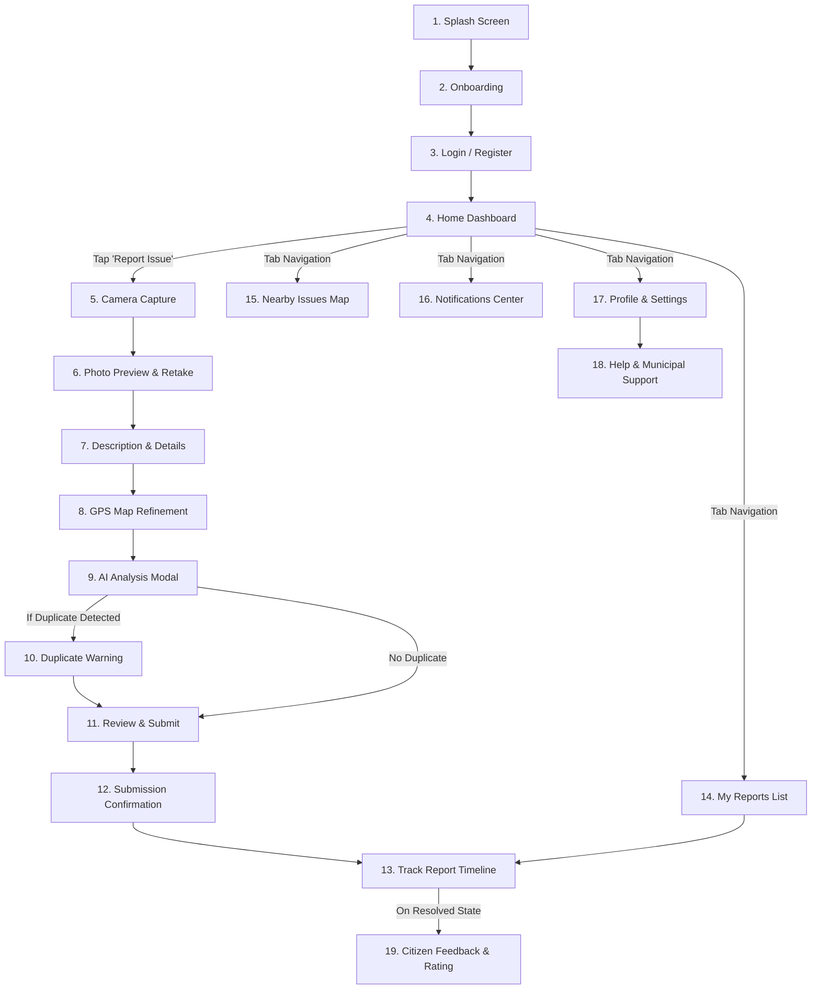
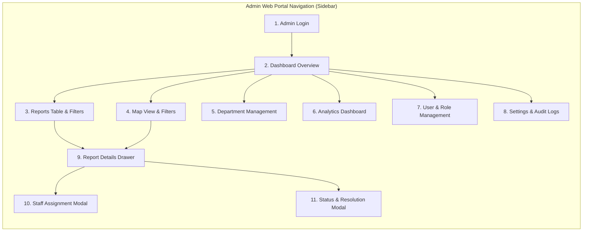

# Document 03 — UI/UX Design System and Screen Specifications
## CivicCare: Visual Language, Design Tokens, and Comprehensive Screen Blueprint

---

### 1. Document Control & Design Baseline
- **Document Identifier:** CIVIC-UI-003
- **Status:** Approved Design System Specification
- **Version:** 1.0.0
- **Visual Baseline Artifact:** `image.png`
  - *Citizen Mobile App (React Native):* Screens 1 through 7
  - *Municipal Admin Dashboard (React Web):* Screens 8 and 9 + Report Details Slide-over Drawer

---

### 2. Design Philosophy & Aesthetic Principles

In accordance with modern civic technology standards and the UI reference in `image.png`, CivicCare rejects generic or cluttered public-sector layouts in favor of an **ultra-clean, high-trust, and accessible design system**:
1. **Civic Trust & Clarity:** Grounded in a calming palette of pristine white, whisper blues, and authoritative deep navy text that inspires credibility.
2. **Effortless Mobile First:** Crucial touch points (such as the large primary `Report an Issue` button and camera triggers) are positioned in the prime thumb zone for one-handed operation on the street.
3. **Glanceable Status Architecture:** High-contrast pill badges and distinct semantic color cues (Red = High/Critical, Amber = In Progress, Green = Resolved) allow citizens and officials to assess situation severity within milliseconds.
4. **Subtle Depth & Micro-interactions:** Clean 12–16px rounded surface cards with delicate hairline borders (`1px solid #E2E8F0`) and light diffuse drop shadows (`0 4px 12px rgba(15, 23, 42, 0.05)`).

---

### 3. Design Tokens & Styling Foundations

#### 3.1 Color Tokens & Semantic Roles

| Token Name | Hex Code | HSL / RGB | Usage & Semantic Purpose |
| :--- | :--- | :--- | :--- |
| **`color-brand-primary`** | `#1E60D5` | `rgb(30, 96, 213)` | Primary interactive buttons, active tab icons, key hyperlinks, brand accents. |
| **`color-brand-hover`** | `#154FB3` | `rgb(21, 79, 179)` | Button hover and pressed active states. |
| **`color-brand-subtle`** | `#EFF6FF` | `rgb(239, 246, 255)` | Active item backgrounds, subtle selection glows, highlight cards. |
| **`color-bg-canvas`** | `#FFFFFF` | `rgb(255, 255, 255)` | Pure white mobile card backgrounds, modal canvases, desktop content panels. |
| **`color-bg-subtle`** | `#F8FAFC` | `rgb(248, 250, 252)` | App body background, table alternating rows, secondary input fills. |
| **`color-text-main`** | `#0F172A` | `rgb(15, 23, 42)` | Deep navy text for headings, titles, high-emphasis labels. |
| **`color-text-muted`** | `#64748B` | `rgb(100, 116, 139)` | Subtitles, helper text, timestamps, character counts, inactive tabs. |
| **`color-border`** | `#E2E8F0` | `rgb(226, 232, 240)` | Card borders, input outlines, table divider lines. |
| **`color-success`** | `#16A34A` | `rgb(22, 163, 74)` | Success icons, "Resolved" status pill, completion checks. |
| **`color-success-bg`** | `#DCFCE7` | `rgb(220, 252, 231)` | Background for "Resolved" pills and positive metric callouts. |
| **`color-warning`** | `#D97706` | `rgb(217, 119, 6)` | "In Progress" status pill, duplicate warning headers, medium severity. |
| **`color-warning-bg`** | `#FEF3C7` | `rgb(254, 243, 199)` | Background for "In Progress" pills and warning notices. |
| **`color-danger`** | `#DC2626` | `rgb(220, 38, 38)` | "High Severity" badge, error alerts, hazardous map pins, delete actions. |
| **`color-danger-bg`** | `#FEE2E2` | `rgb(254, 226, 226)` | Background for high-severity badges and destructive warnings. |
| **`color-info`** | `#0284C7` | `rgb(2, 132, 199)` | "Pending" / "Submitted" status badges, informational banners. |
| **`color-info-bg`** | `#E0F2FE` | `rgb(224, 242, 254)` | Background for pending status pills. |

#### 3.2 Typography Scale (Inter / System Sans-Serif)

| Level / Token | Font Size | Line Height | Font Weight | Letter Spacing | Context of Use |
| :--- | :--- | :--- | :--- | :--- | :--- |
| **`display-1`** | 32px (2.0rem) | 40px | 700 (Bold) | -0.02em | Onboarding titles, landing splash headers. |
| **`heading-1`** | 24px (1.5rem) | 32px | 700 (Bold) | -0.01em | Mobile screen titles ("Report Issue", "Report Details"), Admin page titles. |
| **`heading-2`** | 18px (1.125rem)| 26px | 600 (SemiBold) | 0.0em | Card headers, section dividers ("Recent Reports Nearby"). |
| **`heading-3`** | 16px (1.0rem) | 24px | 600 (SemiBold) | 0.0em | Modal titles, table headers, drawer subheaders. |
| **`body-default`**| 14px (0.875rem)| 20px | 400 (Regular) | 0.0em | Body paragraphs, issue descriptions, form input values. |
| **`body-medium`** | 14px (0.875rem)| 20px | 500 (Medium) | 0.0em | Button labels, navigation links, list titles. |
| **`caption`** | 12px (0.75rem) | 16px | 500 (Medium) | 0.01em | Status pill text, timeline timestamps, metadata tags, character counts. |

#### 3.3 Spacing, Radii, and Elevation Tokens

- **Grid Base Unit:** $4\text{px}$ / $8\text{px}$ standard spacing rhythm.
  - Spacing Scale: `space-1` (4px), `space-2` (8px), `space-3` (12px), `space-4` (16px), `space-6` (24px), `space-8` (32px), `space-12` (48px).
- **Corner Radii:**
  - Badges / Small Pills: `rounded-full` ($9999\text{px}$)
  - Buttons / Text Inputs: `rounded-xl` ($12\text{px}$)
  - Surface Cards / Panels: `rounded-2xl` ($16\text{px}$)
  - Modals / Action Sheets: `rounded-3xl` ($24\text{px}$)
- **Elevation / Shadows:**
  - `shadow-sm`: `0 1px 2px rgba(15, 23, 42, 0.05)` (Inputs, subtle dividers)
  - `shadow-md`: `0 4px 12px rgba(15, 23, 42, 0.08)` (Cards, list rows)
  - `shadow-lg`: `0 12px 28px rgba(15, 23, 42, 0.12)` (Drawers, dropdown popups)
  - `shadow-modal`: `0 24px 48px rgba(15, 23, 42, 0.18)` (Dialog modals, floating action bars)

---

### 4. Reusable UI Component Specifications

#### 4.1 Buttons
- **Primary Button:** Full-width or inline rounded pill ($12\text{px}$ radius), background `#1E60D5`, text `#FFFFFF`, height $48\text{px}$ (mobile) / $40\text{px}$ (web). Hover `#154FB3`. Pressed scale `0.98`.
- **Secondary / Ghost Button:** Transparent background, $1\text{px}$ border `#CBD5E1`, text `#0F172A`. Hover background `#F1F5F9`.
- **Destructive Button:** Background `#DC2626`, text `#FFFFFF`, used strictly for reject/delete confirmations.

#### 4.2 Status & Severity Badges
- **Status Pills:** Height $24\text{px}$, padding `4px 10px`, font size $12\text{px}$ semi-bold, rounded-full:
  - `Submitted` / `Pending`: Light blue background (`#E0F2FE`), text `#0284C7`.
  - `In Progress`: Light amber background (`#FEF3C7`), text `#D97706`.
  - `Resolved`: Light emerald background (`#DCFCE7`), text `#16A34A`.
- **Severity Badges:** Shield icon + text label:
  - `High` / `Critical`: Light red background (`#FEE2E2`), text `#DC2626`, icon red shield.
  - `Medium`: Light orange background (`#FFEDD5`), text `#EA580C`.
  - `Low`: Light slate background (`#F1F5F9`), text `#475569`.

#### 4.3 Form Inputs & Text Areas
- **Text Inputs:** Height $44\text{px}$, border `1px solid #E2E8F0`, background `#FFFFFF`, text `#0F172A`. Focused: border `2px solid #1E60D5` with subtle blue halo (`box-shadow: 0 0 0 3px rgba(30, 96, 213, 0.15)`).
- **Description Area:** Minimum height $96\text{px}$, resizable disabled on mobile, character counter right-aligned at bottom in `#94A3B8`.

---

### 5. Detailed Specifications: 19 Citizen Mobile App Screens

#### Screen 01: Splash Screen
- **Visual Reference:** Screen 1 in `image.png`
- **Purpose:** Brand entrance and application initialization.
- **Layout:** Centered vertical stack; high-rise cityscape roadway illustration at bottom; CivicCare logo with green building leaf emblem; tagline: *"Report, Track, Build a Better City Together."*
- **Actions:** Primary button `"Get Started"` (navigates to Onboarding/Home); Text button `"Already have an account? Sign In"` (navigates to Login).

#### Screen 02: Onboarding Flow
- **Visual Reference:** Screen 2 in `image.png`
- **Purpose:** Educate first-time citizens on the 3-step reporting process.
- **Layout:** Top bar with `"Skip"` button; central vector illustration (hand holding smartphone with photo and pin); headline: `"Report Civic Issues"`; body text: `"Click a photo, add a description and location to report issues in your city."`; 3-dot pagination indicator.
- **Actions:** Primary button `"Next"` (progresses through slides, transitions to Home on final slide).

#### Screen 03: Login & Authentication
- **Purpose:** Secure citizen authentication via Mobile Number OTP or Social Auth.
- **Layout:** Clean white card; phone number input with country code picker (`+91`); `"Send OTP"` button; 6-digit PIN input cells with auto-focus; alternative Google/Apple sign-in buttons.
- **Validation:** Enforces 10-digit valid mobile number format; 60-second OTP cooldown resend timer.

#### Screen 04: Home Dashboard
- **Visual Reference:** Screen 3 in `image.png`
- **Purpose:** Main hub for initiating reports and checking local civic health.
- **Layout:**
  - Header: Location selector with pin icon (`"Mumbai"`), notification bell, citizen avatar.
  - Search Bar: `"Search for issues near you..."` with filter icon.
  - Civic Hero Banner: Illustrated city park card with text *"Together for a Cleaner, Safer City — Report civic issues and help make a difference."*
  - Central Action Button: Extra-prominent blue button `[Camera Icon] Report an Issue`.
  - Issue Category Grid: 6 circular cards with icons: `Pothole`, `Garbage`, `Streetlight`, `Water Leak`, `Broken Road`, `Others`.
  - Section: `"Recent Reports Nearby"` with `"View All"` link; horizontal scrollable cards displaying thumbnail, title, time/distance (`"2 hours ago • 0.8 km"`), and status badge (`In Progress`).

#### Screen 05: Issue Category Selection (Pre-capture or Direct)
- **Purpose:** Allow citizen to pre-select category prior to camera, or browse category guides.
- **Components:** 2-column grid of rich category cards displaying icon, typical department, and resolution SLA expectations.

#### Screen 06: Camera Capture
- **Purpose:** High-fidelity photo capture of physical infrastructure failure.
- **Layout:** Full-screen camera viewfinder; top controls: Flash toggle (Off/On/Auto), camera flip; bottom bar: Shutter button (white ring with blue center), gallery picker shortcut, cancel button.
- **Hardware Integration:** Locks autofocus and requests high-precision location fix simultaneously in the background.

#### Screen 07: Photo Preview and Retake
- **Visual Reference:** Screen 4 in `image.png` (Media section)
- **Purpose:** Review captured image clarity before proceeding.
- **Components:** Image container with rounded corners ($16\text{px}$); top-right overlay `"X"` delete button; adjacent dashed container `[+] Add More Photos` supporting up to 2 additional angles.

#### Screen 08: Description and Additional Details
- **Visual Reference:** Screen 4 in `image.png`
- **Purpose:** Capture text description and contextual remarks.
- **Components:** Form label `"Issue Description"`; multiline text input with placeholder *"Describe the issue and nearby landmarks..."*; counter label `"75/300"`.
- **Validation:** Minimum 10 characters required to prevent empty submissions.

#### Screen 09: GPS Location Selection & Verification
- **Visual Reference:** Screen 4 in `image.png` (Auto-detected Location section)
- **Purpose:** Ensure precise geocoding of the reported issue.
- **Components:** Embedded interactive map preview with red pin; street address card: `"MG Road, Andheri West, Mumbai, Maharashtra"`; blue text action `"Change"` opening draggable full-screen pin selector.
- **Actions:** Primary blue button `"Submit Report"`.

#### Screen 10: AI Analysis & Real-Time Prediction Review
- **Visual Reference:** Screen 5 in `image.png`
- **Purpose:** Visual transparency while asynchronous computer vision models classify evidence.
- **Layout:** Central glowing neural brain emblem; headline: `"Analyzing your report..."`; subtext: *"Our AI is analyzing the image and description to detect the issue type and severity."*
- **Checklist Animation:**
  - `[✓] Image analysis` (Completed green check)
  - `[✓] Text analysis` (Completed green check)
  - `[⟳] Detecting category` (Spinning progress circle)
  - `[○] Estimating severity` (Pending circle)
  - `[○] Finding similar reports` (Pending circle)

#### Screen 11: Duplicate Warning Modal
- **Purpose:** Intercept redundant submissions within a 50-meter radius.
- **Layout:** Slide-up sheet; warning header with amber alert icon: `"Possible Duplicate Issue Detected"`; subtext: *"A similar report was submitted 3 hours ago within 25 meters of your location."*
- **Comparison View:** Side-by-side card comparing existing report photo/time vs. citizen's newly snapped photo.
- **Actions:** Primary Button `"Upvote & Track Existing"` (adds citizen as subscriber); Secondary Button `"Submit New Report Anyway"`.

#### Screen 12: Review and Final Submit
- **Purpose:** Final validation screen displaying summarized image, category badge, severity estimate, address, and description.
- **Action:** `"Confirm & Submit"` button with biometric or one-tap submission.

#### Screen 13: Successful Submission Screen
- **Visual Reference:** Screen 6 in `image.png`
- **Purpose:** Celebrate submission and provide tracking reference.
- **Layout:** Centered green circle with white checkmark badge; headline: `"Report Submitted!"`; subtext: *"Your issue has been successfully reported and is being processed by AI."*
- **Ticket Summary Card:**
  - Report ID: `#CC20241026` with clipboard copy icon button.
  - Detected Category: `Pothole` with road icon.
  - Severity: `High` with red badge and shield icon.
  - Location: `MG Road, Andheri West, Mumbai` with pin icon.
- **Actions:** Primary Button `"Track This Report"`; Secondary Ghost Button `"Submit Another Report"`.

#### Screen 14: My Reports Screen
- **Purpose:** Manage all personal historical and active complaints.
- **Components:** Segmented filter control: `All (12)`, `Active (3)`, `Resolved (9)`.
- **List Item Card:** Thumbnail, Title (`Pothole on MG Road`), ID, submission date, status badge, right arrow indicator.

#### Screen 15: Report Details & Timeline Screen
- **Visual Reference:** Screen 7 in `image.png`
- **Purpose:** Detailed step-by-step progress tracking for an individual ticket.
- **Layout:**
  - Header: Back arrow, Title `"Report Details"`, floating status badge `In Progress` (amber).
  - High-resolution photo header with zoom capability.
  - Title & Reference: `"Pothole on MG Road"`, `#CC20241026`.
  - Vertical Chronological Timeline:
    1. `[✓] Report Submitted` | Oct 26, 2024, 10:30 AM | *"Your report has been received."*
    2. `[✓] AI Classification` | Oct 26, 2024, 10:31 AM | *"Detected as Pothole (High Severity)"*
    3. `[✓] Sent to Road Maintenance Dept.` | Oct 26, 2024, 10:35 AM | *"Your report has been routed to the appropriate department."*
    4. `[⟳] In Progress` | Oct 26, 2024, 2:15 PM | *"Department has started working on the issue."*
    5. `[○] Resolved` | Pending

#### Screen 16: Nearby Issues Map
- **Purpose:** Explore crowd-sourced issues in the neighborhood.
- **Components:** Full-screen vector map; category filter carousel at top; cluster markers; tapping a marker opens a bottom card preview with thumbnail and status.

#### Screen 17: Notifications Center
- **Purpose:** Chronological log of system alerts, department reassignments, and resolution notices.
- **Items:** Unread blue dot indicators, timestamp, deep link to corresponding Report Details screen.

#### Screen 18: Profile and Settings
- **Purpose:** Citizen account preferences, registered mobile number, notification toggles (Push/SMS), language selector (English, Hindi, Marathi), Privacy Policy.

#### Screen 19: Citizen Feedback & Resolution Dispute
- **Purpose:** Quality evaluation upon ticket transition to `RESOLVED`.
- **Components:** 5-star rating selector; resolution evidence photo thumbnail; question: *"Did this resolve the issue completely?"*; buttons: `"Yes, Close Ticket"` (prompts rating) / `"No, Dispute & Reopen"` (requires explanation and counter-photo).

---

### 6. Detailed Specifications: 11 Municipal Admin Web Screens

#### Screen 01: Municipal Admin Login
- **Purpose:** Authenticate municipal officers with role-based credentials.
- **Components:** Centered card on light-blue gradient; CivicCare Admin crest; municipal email input; password input with show/hide toggle; 2-Factor Authentication (2FA) verification code.

#### Screen 02: Dashboard Overview
- **Visual Reference:** Screen 8 in `image.png`
- **Purpose:** Executive command center for civic complaint volume and status.
- **Layout & Components:**
  - Left Sidebar: Dark navy background (`#0F172A`); CivicCare Admin logo; navigation links with icons: `Dashboard` (active blue pill), `Reports`, `Map View`, `Departments`, `Analytics`, `Users`, `Settings`.
  - Top Navigation Bar: Title `"Dashboard"` with subtitle *"Overview of civic issues and resolution status"*; notification bell with badge; user avatar badge *"Admin — Road Maintenance Dept."*
  - Top Metric KPI Cards (4 Cards):
    1. `Total Reports`: **1,284** (`+12% from last month`, green sub-label)
    2. `Pending`: **342** (`+5%`, blue sub-label)
    3. `In Progress`: **516** (`+18%`, amber sub-label)
    4. `Resolved`: **426** (`+25%`, green sub-label)
  - Middle Visualizations (2 Columns):
    - *Left Chart:* `"Reports Trend"` 7-day multi-line chart (Oct 20–26) comparing `Submitted` (blue line) vs. `Resolved` (green line).
    - *Right Chart:* `"Reports by Category"` Donut chart with central callout `1,284 Total`:
      - Pothole: 35%
      - Garbage: 22%
      - Streetlight: 18%
      - Water Leak: 12%
      - Broken Road: 8%
      - Others: 5%
  - Bottom Section: `"Recent Reports"` Data Table with `"View All"` link:
    - Columns: `ID`, `Image`, `Title`, `Category`, `Severity`, `Location`, `Status`, `Date`.
    - Sample Row 1: `#CC20241026` | [Thumbnail] | `Pothole on MG Road` | `Pothole` | `High` (red badge) | `Andheri West` | `In Progress` (amber) | `Oct 26, 10:30 AM`

#### Screen 03: Report List & Advanced Filtering
- **Purpose:** High-density tabular workspace for triaging, searching, and bulk-processing reports.
- **Filters Bar:** Search by ID/keyword; Category dropdown; Status multi-select; Severity dropdown; Date range picker; Ward selector.
- **Table Features:** Sortable columns, pagination controls (25/50/100 rows per page), bulk export to CSV/Excel.

#### Screen 04: Map View & Geospatial Hotspot Inspector
- **Visual Reference:** Screen 9 in `image.png`
- **Purpose:** Spatial situational awareness and geographical dispatching.
- **Layout:**
  - Top Filters: `All Categories`, `All Status`, `All Severity`, Date Range `Oct 1, 2024 - Oct 26, 2024`.
  - Map Canvas: Vector map centered on Mumbai (Andheri West, Bandra, Powai, Kurla); color-coded map pins (Red = High/Critical, Yellow/Amber = In Progress, Green = Resolved).
  - Interactive Pin Popup:
    - Thumbnail image of the issue.
    - Title: `"Pothole on MG Road"`, ID: `#CC20241026`.
    - Severity Badge: `High` (red shield).
    - Location: `Andheri West, Mumbai` | `Oct 26, 2024, 10:30 AM`.
    - Action: Blue button `"View Details"` (opens Report Details Drawer).

#### Screen 05: Report Details Slide-over Drawer
- **Visual Reference:** Screen 10 (Right Drawer) in `image.png`
- **Purpose:** Comprehensive inspection and workflow updating for a selected ticket.
- **Header:** `< Report Details`, thumbnail image, title `"Pothole on MG Road"`, ID `#CC20241026`, severity badge `High`, location, and submission timestamp.
- **Tabbed Sections:** `Details`, `Timeline`, `Similar Reports`.
- **Form Controls:**
  - Description: Read-only text box with citizen description.
  - Category: Badge with icon `[Road] Pothole (AI Classified)` with `[Edit Pencil]` icon for manual override.
  - Severity: `High` badge.
  - Location: Address text with clickable blue link `[View on Map]`.
  - Assigned Department: Select dropdown (e.g., `"Road Maintenance Department"`).
  - Status: Select dropdown (`Submitted`, `In Progress`, `Resolved`, `Rejected`).
  - Assigned To: Select dropdown (e.g., `"John D'souza"`).
  - Remarks: Multiline text input for internal staff notes (*"Work started. Expected completion in 2 days."*).
- **Primary Action:** Blue button `"Update Report"` (commits database transaction, notifies citizen).

#### Screen 06: Department Management
- **Purpose:** Configure municipal departments, boundary polygons, service catalog, and lead supervisors.
- **Components:** Department list cards displaying active headcount, open ticket count, average resolution time, and SLA compliance score.

#### Screen 07: Staff Assignment & Roster Modal
- **Purpose:** Dispatch specific field crews or maintenance vans.
- **Components:** Searchable staff directory filtered by current department; displays active workload (e.g., `"3 active tickets assigned"`) and contact details.

#### Screen 08: Status & Resolution Evidence Modal
- **Purpose:** Enforce verifiable closure proof before tickets can be finalized.
- **Components:** File drop-zone for uploading post-repair photographs; verification checkbox: *"I confirm physical repair adheres to municipal quality standards"*; resolution notes field; `"Approve & Mark Resolved"` button.

#### Screen 09: Analytics & Performance Dashboard
- **Purpose:** Macro-level urban intelligence and departmental SLA reporting.
- **Charts:**
  - Mean Time to Resolution (MTTR) by department.
  - Pothole re-emergence rate (hotspot recurrence).
  - Ward-by-ward civic health index map.

#### Screen 10: User and Role Management
- **Purpose:** Centralized access control for municipal personnel.
- **Components:** User table with role assignment dropdowns (`Field Worker`, `Supervisor`, `Super Admin`), department tags, and deactivate account buttons.

#### Screen 11: Settings and Audit History
- **Purpose:** Compliance tracking and system configuration.
- **Components:** Immutable audit table recording every action (`User`, `Action`, `Target Ticket`, `Old Value`, `New Value`, `Timestamp`, `IP Address`).

---

### 7. Responsive Breakpoints & Device Adaptations

| Breakpoint Token | Min Width | Target Viewports | Layout Adjustments |
| :--- | :--- | :--- | :--- |
| **`sm`** | $360\text{px}$ | Compact Mobile (iPhone SE, Galaxy A) | Single column; bottom navigation bar; sticky report CTA button. |
| **`md`** | $768\text{px}$ | Tablets, Foldables | 2-column home cards; modal bottom sheets convert to centered dialogs. |
| **`lg`** | $1024\text{px}$| Desktop, Laptops (Admin Web) | Collapsible 240px sidebar; 2-column KPI dashboards; slide-over drawer 420px. |
| **`xl`** | $1440\text{px}$| Large Desktop Displays | Full widescreen split layout (50% Map View, 50% Live Triage Data Grid). |

---
*Next Document: [Document 04 — Technical Architecture](file:///d:/SOURCE%20CODE/BUSINESS/CIVIC%20CARE/docs/04_TECHNICAL_ARCHITECTURE.md)*
