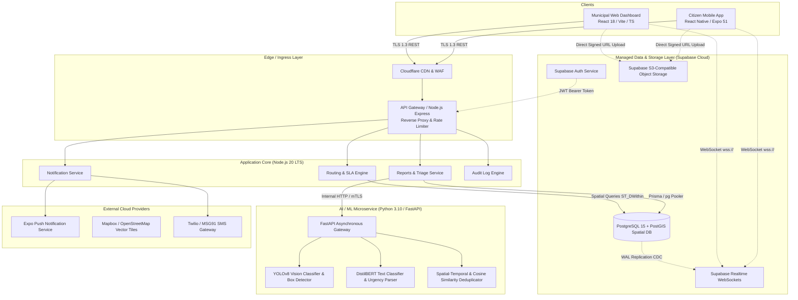
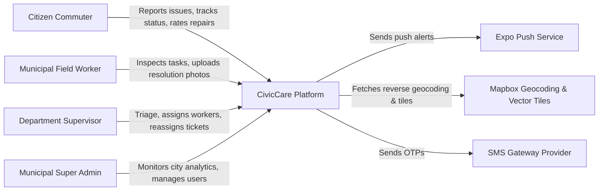
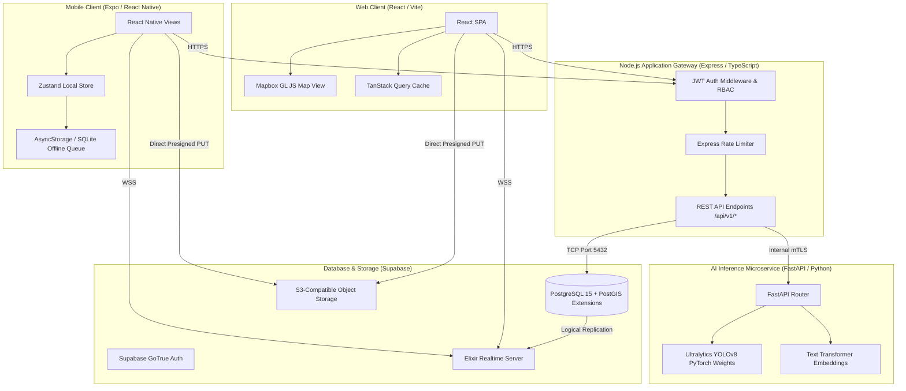
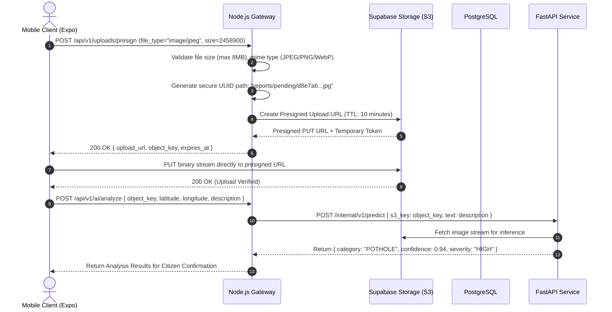
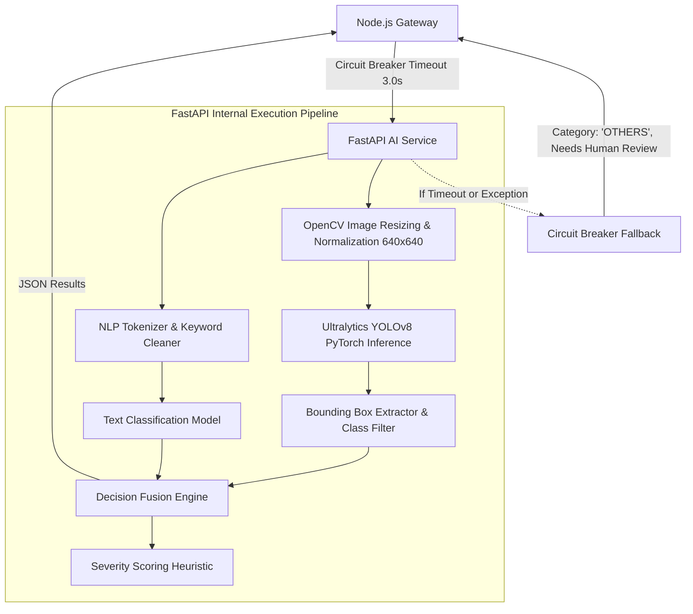
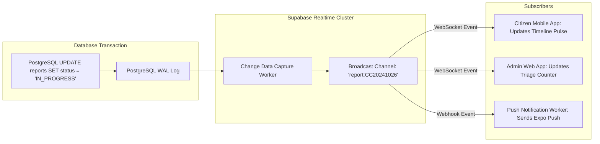

# Document 04 — Technical Architecture
## CivicCare: Distributed System Architecture, C4 Models, Service Boundaries, and Integration Topology

---

### 1. Document Control & Metadata
- **Document Identifier:** CIVIC-ARCH-004
- **Status:** Approved Architectural Blueprint
- **Version:** 1.0.0
- **Author:** Lead Systems Architect
- **Primary Technical Scope:** Microservice boundaries, authentication topology, PostGIS data flows, AI inference pipeline, and cloud deployment topology.

---

### 2. Architectural Paradigm & System Overview

CivicCare is architected around a **Decoupled Edge-First Cloud Architecture**. The system separates compute-heavy deep learning inference from high-concurrency transactional API workflows and geospatial database queries.

---

### 3. C4 Architectural Blueprint

#### 3.1 C4 Level 1: System Context Diagram
The System Context diagram illustrates how external actors interact with the CivicCare software boundary.

*Plain-Language Summary:* Citizens interface via mobile devices to upload evidence and receive real-time updates. Municipal staff and supervisors use web portals to inspect, assign, and resolve tickets. CivicCare interfaces with external mapping, push notification, and SMS infrastructure to provide location context and timely alerts.

#### 3.2 C4 Level 2: Container Diagram
The Container diagram breaks down the executable units running across the infrastructure.

*Plain-Language Summary:* The client applications communicate with a secure Node.js API Gateway that handles business logic, authorization, and database transactions. The Node.js service calls a dedicated Python FastAPI service for AI inference. High-volume media uploads bypass the application server, streaming directly to Supabase S3 storage via pre-signed URLs.

---

### 4. Authentication Architecture: Clerk vs. Supabase Auth Comparison

The prompt requires a rigorous architectural comparison between **Clerk** and **Supabase Auth** before finalizing the system baseline.

| Architectural Evaluation Criteria | Clerk Authentication | Supabase Auth (GoTrue) |
| :--- | :--- | :--- |
| **Native Database Integration** | External provider. Requires webhook listeners (`user.created`, `user.updated`) and a custom sync worker to maintain local PostgreSQL `profiles` records. | **Native.** Automatically populates `auth.users` inside PostgreSQL; perfectly syncs with `public.profiles` via database triggers. |
| **Row Level Security (RLS)** | High complexity. PostgreSQL RLS relies on `auth.uid()`. Integrating Clerk requires custom JWT signing keys and setting session variables (`request.jwt.claims`) per connection. | **Zero Overhead.** Seamless out-of-the-box RLS integration. `auth.uid()` and custom app claims are natively evaluated by the Postgres engine. |
| **Mobile SDK Support (Expo)** | Excellent drop-in UI components, but heavily web-oriented; native Expo SDK requires OAuth web browser popups. | Robust `@supabase/supabase-js` client with native AsyncStorage session persistence and mobile SMS OTP. |
| **Pricing & Scaling Constraints** | Free tier capped at 10,000 Monthly Active Users (MAUs). Overage fees apply ($0.02 to $0.05 per active user thereafter). | Free tier includes 50,000 MAUs. Pro tier is flat $25/month for 100,000 MAUs with unlimited database capabilities. |
| **Realtime Token Propagation** | Requires dual-token lifecycle management: Clerk JWT for API calls, secondary Supabase token for Realtime subscriptions. | Unified JWT token used across Database queries, Storage upload policies, and Realtime WebSocket subscriptions. |
| **Operational Attack Surface** | Two vendor security surfaces and third-party webhook failure risks. | Single cohesive security boundary within Supabase Cloud. |

#### Architectural Recommendation & Decision:
**Selected Baseline: Supabase Auth.**
*Justification:* CivicCare relies heavily on PostgreSQL Row-Level Security (RLS) policies to isolate citizen data, restrict status transitions, and enforce municipal role boundaries. Supabase Auth natively binds JWT identity directly to `auth.uid()` at the database engine level without webhook latency, external synchronization failures, or multi-token mismatch issues during Realtime WebSocket subscriptions.

---

### 5. Media Ingestion & Secure Upload Architecture

To prevent API gateway memory saturation from multi-megabyte citizen photographs, CivicCare implements an **Asynchronous Direct Pre-signed Storage Pattern**.

#### Key Architecture Safeguards:
1. **Zero Gateway Proxying:** Images never stream through the Node.js API process, preventing heap memory exhaustion under peak incident surges.
2. **Strict MIME & Magic Byte Validation:** Supabase Storage bucket policies reject files failing image header signatures.
3. **Private Bucket Isolation:** The `report-images` bucket is completely private. Client access requires time-limited signed read URLs (max 15-minute TTL) generated dynamically.

---

### 6. AI Microservice Architecture & Fault Tolerance

The AI inference layer operates as an independent Python FastAPI microservice running inside an isolated Docker container.

#### Circuit Breaker & Graceful Degradation Rules:
- **Execution Budget:** Maximum inference execution window is $3,000\text{ ms}$.
- **Fallback Trigger:** If FastAPI takes $> 3,000\text{ ms}$ or returns HTTP 500, the Node.js API automatically falls back to an unverified submission state (`ai_processed = false`, `category = OTHERS`).
- **Asynchronous Reconciliation:** A BullMQ background worker polls unprocessed tickets every 60 seconds and retries inference once the AI service capacity normalizes.

---

### 7. Realtime Synchronization & Event-Driven Architecture

CivicCare utilizes PostgreSQL Write-Ahead Log (WAL) Logical Replication via Supabase Realtime to push live events to mobile and web clients without polling.

---

### 8. Environmental Topology & Infrastructure Specifications

| Infrastructure Layer | Development Environment | Staging Environment | Production Environment |
| :--- | :--- | :--- | :--- |
| **Mobile App (Expo)** | Expo Go / Local Dev Client | Expo EAS Internal Preview Build | iOS App Store & Google Play Store |
| **Admin Web App** | Vite Dev Server (`localhost:5173`) | Vercel Preview Deployment | Vercel Production Custom Domain with Cloudflare WAF |
| **Node.js API Gateway** | Local Node 20 (`localhost:4000`) | Render / Railway Staging Service | AWS ECS Fargate Container Cluster (Auto-scaling 2–8 tasks) |
| **Python AI Microservice** | Local Python 3.10 FastAPI (`localhost:8000`) | Render GPU / Docker Staging | AWS ECS Fargate or RunPod / Modal GPU Server |
| **PostgreSQL & Storage** | Supabase Local CLI (Docker) | Supabase Cloud Pro Staging Project | Supabase Cloud Pro Production with PostGIS & Daily Backups |

---
*Next Document: [Document 05 — Database Schema and Data Dictionary](file:///d:/SOURCE%20CODE/BUSINESS/CIVIC%20CARE/docs/05_DATABASE_SCHEMA_AND_DATA_DICTIONARY.md)*
