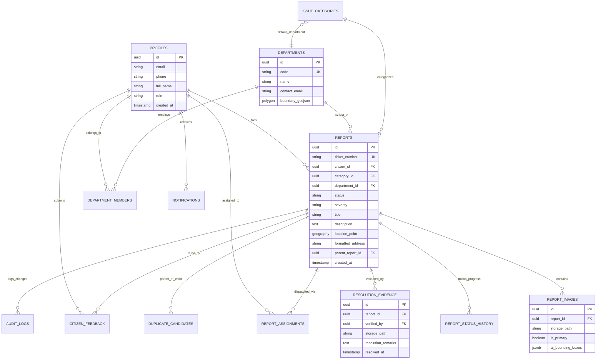

# Document 05 — Database Schema and Data Dictionary
## CivicCare: Relational Data Architecture, PostGIS Spatial Indexing, and Row-Level Security

---

### 1. Document Control & Metadata
- **Document Identifier:** CIVIC-DB-005
- **Status:** Approved Database DDL & Schema Architecture
- **Version:** 1.0.0
- **Database Engine:** PostgreSQL 15+ (Supabase Managed Engine)
- **Extensions Required:** `uuid-ossp`, `postgis`, `pgcrypto`

---

### 2. Entity-Relationship (ER) Architecture

The database model is normalized to Third Normal Form (3NF) to guarantee transactional integrity, auditability, and spatial querying efficiency.



---

### 3. Enumerations & Custom Types

```sql
-- Status lifecycle states for civic complaints
CREATE TYPE report_status_enum AS ENUM (
    'SUBMITTED',
    'AI_VERIFIED',
    'ROUTED',
    'ASSIGNED',
    'IN_PROGRESS',
    'RESOLVED',
    'CLOSED',
    'REJECTED',
    'DUPLICATE',
    'REOPENED'
);

-- Operational hazard severity ratings
CREATE TYPE severity_level_enum AS ENUM (
    'LOW',
    'MEDIUM',
    'HIGH',
    'CRITICAL'
);

-- Ecosystem role-based access levels
CREATE TYPE user_role_enum AS ENUM (
    'CITIZEN',
    'FIELD_WORKER',
    'DEPT_SUPERVISOR',
    'SUPER_ADMIN'
);
```

---

### 4. Complete PostgreSQL DDL (Data Definition Language)

```sql
-- Enable mandatory PostgreSQL extensions
CREATE EXTENSION IF NOT EXISTS "uuid-ossp";
CREATE EXTENSION IF NOT EXISTS "postgis";
CREATE EXTENSION IF NOT EXISTS "pgcrypto";

-- ============================================================================
-- 1. PROFILES (Extends Supabase auth.users)
-- ============================================================================
CREATE TABLE public.profiles (
    id UUID PRIMARY KEY REFERENCES auth.users(id) ON DELETE CASCADE,
    full_name VARCHAR(150) NOT NULL,
    phone_number VARCHAR(20) UNIQUE,
    email VARCHAR(255) UNIQUE,
    role user_role_enum NOT NULL DEFAULT 'CITIZEN',
    preferred_language VARCHAR(10) DEFAULT 'en',
    avatar_url TEXT,
    is_active BOOLEAN DEFAULT TRUE,
    created_at TIMESTAMPTZ DEFAULT TIMEZONE('utc', NOW()) NOT NULL,
    updated_at TIMESTAMPTZ DEFAULT TIMEZONE('utc', NOW()) NOT NULL
);

-- ============================================================================
-- 2. DEPARTMENTS
-- ============================================================================
CREATE TABLE public.departments (
    id UUID PRIMARY KEY DEFAULT uuid_generate_v4(),
    code VARCHAR(30) UNIQUE NOT NULL, -- e.g., 'ROAD_MAINTENANCE'
    name VARCHAR(150) NOT NULL,
    description TEXT,
    contact_email VARCHAR(255) NOT NULL,
    contact_phone VARCHAR(20),
    sla_hours INTEGER NOT NULL DEFAULT 48,
    is_active BOOLEAN DEFAULT TRUE,
    created_at TIMESTAMPTZ DEFAULT TIMEZONE('utc', NOW()) NOT NULL
);

-- ============================================================================
-- 3. DEPARTMENT MEMBERS (Staff & Supervisors)
-- ============================================================================
CREATE TABLE public.department_members (
    id UUID PRIMARY KEY DEFAULT uuid_generate_v4(),
    department_id UUID NOT NULL REFERENCES public.departments(id) ON DELETE CASCADE,
    profile_id UUID NOT NULL REFERENCES public.profiles(id) ON DELETE CASCADE,
    designation VARCHAR(100),
    is_head BOOLEAN DEFAULT FALSE,
    assigned_at TIMESTAMPTZ DEFAULT TIMEZONE('utc', NOW()) NOT NULL,
    UNIQUE(department_id, profile_id)
);

-- ============================================================================
-- 4. ISSUE CATEGORIES
-- ============================================================================
CREATE TABLE public.issue_categories (
    id UUID PRIMARY KEY DEFAULT uuid_generate_v4(),
    code VARCHAR(50) UNIQUE NOT NULL, -- e.g., 'POTHOLE', 'GARBAGE'
    name VARCHAR(100) NOT NULL,
    default_department_id UUID REFERENCES public.departments(id),
    default_severity severity_level_enum DEFAULT 'MEDIUM',
    icon_name VARCHAR(50) NOT NULL,
    is_active BOOLEAN DEFAULT TRUE
);

-- ============================================================================
-- 5. REPORTS (Primary Civic Incident Entity)
-- ============================================================================
CREATE TABLE public.reports (
    id UUID PRIMARY KEY DEFAULT uuid_generate_v4(),
    ticket_number VARCHAR(30) UNIQUE NOT NULL, -- e.g., '#CC20241026'
    citizen_id UUID NOT NULL REFERENCES public.profiles(id),
    category_id UUID NOT NULL REFERENCES public.issue_categories(id),
    department_id UUID REFERENCES public.departments(id),
    status report_status_enum NOT NULL DEFAULT 'SUBMITTED',
    severity severity_level_enum NOT NULL DEFAULT 'MEDIUM',
    title VARCHAR(200) NOT NULL,
    description TEXT NOT NULL,
    
    -- PostGIS Geodetic Point (WGS 84 / SRID 4326)
    location GEOGRAPHY(Point, 4326) NOT NULL,
    latitude DOUBLE PRECISION NOT NULL,
    longitude DOUBLE PRECISION NOT NULL,
    formatted_address TEXT NOT NULL,
    postal_code VARCHAR(20),
    ward_zone VARCHAR(100),
    
    -- AI Evaluation Metadata
    ai_category_confidence NUMERIC(4,3), -- e.g. 0.942
    ai_raw_predictions JSONB,
    ai_flagged_uncertain BOOLEAN DEFAULT FALSE,
    
    -- Duplicate Clustering
    parent_report_id UUID REFERENCES public.reports(id),
    subscriber_count INTEGER DEFAULT 1,
    
    -- Timestamps
    created_at TIMESTAMPTZ DEFAULT TIMEZONE('utc', NOW()) NOT NULL,
    updated_at TIMESTAMPTZ DEFAULT TIMEZONE('utc', NOW()) NOT NULL
);

-- Create spatial GiST index for ultra-fast radius queries
CREATE INDEX idx_reports_location_gist ON public.reports USING GIST(location);
CREATE INDEX idx_reports_status ON public.reports(status);
CREATE INDEX idx_reports_category ON public.reports(category_id);
CREATE INDEX idx_reports_department ON public.reports(department_id);
CREATE INDEX idx_reports_created_at ON public.reports(created_at DESC);

-- ============================================================================
-- 6. REPORT IMAGES
-- ============================================================================
CREATE TABLE public.report_images (
    id UUID PRIMARY KEY DEFAULT uuid_generate_v4(),
    report_id UUID NOT NULL REFERENCES public.reports(id) ON DELETE CASCADE,
    storage_path TEXT NOT NULL, -- Private S3 key: 'reports/2024/10/uuid.jpg'
    is_primary BOOLEAN DEFAULT TRUE,
    file_size_bytes INTEGER NOT NULL,
    mime_type VARCHAR(50) NOT NULL,
    ai_bounding_boxes JSONB, -- Array of [ymin, xmin, ymax, xmax, label, score]
    created_at TIMESTAMPTZ DEFAULT TIMEZONE('utc', NOW()) NOT NULL
);

CREATE INDEX idx_report_images_report ON public.report_images(report_id);

-- ============================================================================
-- 7. REPORT ASSIGNMENTS (Field Crew Delegation)
-- ============================================================================
CREATE TABLE public.report_assignments (
    id UUID PRIMARY KEY DEFAULT uuid_generate_v4(),
    report_id UUID NOT NULL REFERENCES public.reports(id) ON DELETE CASCADE,
    assigned_by UUID NOT NULL REFERENCES public.profiles(id),
    assigned_to UUID NOT NULL REFERENCES public.profiles(id),
    instructions TEXT,
    deadline TIMESTAMPTZ,
    assigned_at TIMESTAMPTZ DEFAULT TIMEZONE('utc', NOW()) NOT NULL
);

-- ============================================================================
-- 8. REPORT STATUS HISTORY (Audit Timeline)
-- ============================================================================
CREATE TABLE public.report_status_history (
    id UUID PRIMARY KEY DEFAULT uuid_generate_v4(),
    report_id UUID NOT NULL REFERENCES public.reports(id) ON DELETE CASCADE,
    previous_status report_status_enum,
    new_status report_status_enum NOT NULL,
    changed_by UUID REFERENCES public.profiles(id),
    remarks TEXT,
    created_at TIMESTAMPTZ DEFAULT TIMEZONE('utc', NOW()) NOT NULL
);

CREATE INDEX idx_status_history_report ON public.report_status_history(report_id, created_at ASC);

-- ============================================================================
-- 9. RESOLUTION EVIDENCE (Mandatory Post-Repair Proof)
-- ============================================================================
CREATE TABLE public.resolution_evidence (
    id UUID PRIMARY KEY DEFAULT uuid_generate_v4(),
    report_id UUID UNIQUE NOT NULL REFERENCES public.reports(id) ON DELETE CASCADE,
    verified_by UUID NOT NULL REFERENCES public.profiles(id),
    storage_path TEXT NOT NULL, -- S3 path to post-repair photograph
    resolution_remarks TEXT NOT NULL,
    completed_at TIMESTAMPTZ DEFAULT TIMEZONE('utc', NOW()) NOT NULL
);

-- ============================================================================
-- 10. CITIZEN FEEDBACK & DISPUTES
-- ============================================================================
CREATE TABLE public.citizen_feedback (
    id UUID PRIMARY KEY DEFAULT uuid_generate_v4(),
    report_id UUID UNIQUE NOT NULL REFERENCES public.reports(id) ON DELETE CASCADE,
    citizen_id UUID NOT NULL REFERENCES public.profiles(id),
    rating_score INTEGER CHECK (rating_score BETWEEN 1 AND 5),
    feedback_text TEXT,
    is_disputed BOOLEAN DEFAULT FALSE,
    dispute_reason TEXT,
    dispute_image_path TEXT,
    created_at TIMESTAMPTZ DEFAULT TIMEZONE('utc', NOW()) NOT NULL
);

-- ============================================================================
-- 11. DUPLICATE CANDIDATES
-- ============================================================================
CREATE TABLE public.duplicate_candidates (
    id UUID PRIMARY KEY DEFAULT uuid_generate_v4(),
    primary_report_id UUID NOT NULL REFERENCES public.reports(id) ON DELETE CASCADE,
    duplicate_report_id UUID NOT NULL REFERENCES public.reports(id) ON DELETE CASCADE,
    distance_meters NUMERIC(6,2) NOT NULL,
    image_similarity_score NUMERIC(4,3),
    detected_at TIMESTAMPTZ DEFAULT TIMEZONE('utc', NOW()) NOT NULL,
    UNIQUE(primary_report_id, duplicate_report_id)
);

-- ============================================================================
-- 12. NOTIFICATIONS
-- ============================================================================
CREATE TABLE public.notifications (
    id UUID PRIMARY KEY DEFAULT uuid_generate_v4(),
    recipient_id UUID NOT NULL REFERENCES public.profiles(id) ON DELETE CASCADE,
    report_id UUID REFERENCES public.reports(id) ON DELETE CASCADE,
    title VARCHAR(150) NOT NULL,
    body TEXT NOT NULL,
    notification_type VARCHAR(50) NOT NULL,
    is_read BOOLEAN DEFAULT FALSE,
    created_at TIMESTAMPTZ DEFAULT TIMEZONE('utc', NOW()) NOT NULL
);

CREATE INDEX idx_notifications_recipient ON public.notifications(recipient_id, is_read);

-- ============================================================================
-- 13. AUDIT LOGS (Immutable Municipal Operations Ledger)
-- ============================================================================
CREATE TABLE public.audit_logs (
    id UUID PRIMARY KEY DEFAULT uuid_generate_v4(),
    entity_name VARCHAR(50) NOT NULL,
    entity_id UUID NOT NULL,
    action_type VARCHAR(50) NOT NULL, -- 'INSERT', 'UPDATE_STATUS', 'REASSIGN'
    actor_id UUID REFERENCES public.profiles(id),
    old_state JSONB,
    new_state JSONB,
    client_ip INET,
    user_agent TEXT,
    logged_at TIMESTAMPTZ DEFAULT TIMEZONE('utc', NOW()) NOT NULL
);

CREATE INDEX idx_audit_logs_entity ON public.audit_logs(entity_name, entity_id);
```

---

### 5. PostgreSQL Row-Level Security (RLS) Policies

To protect sensitive citizen privacy and enforce administrative authority boundaries, all tables enable RLS.

```sql
-- Enable RLS on core tables
ALTER TABLE public.profiles ENABLE ROW LEVEL SECURITY;
ALTER TABLE public.reports ENABLE ROW LEVEL SECURITY;
ALTER TABLE public.report_images ENABLE ROW LEVEL SECURITY;
ALTER TABLE public.report_status_history ENABLE ROW LEVEL SECURITY;
ALTER TABLE public.resolution_evidence ENABLE ROW LEVEL SECURITY;
ALTER TABLE public.audit_logs ENABLE ROW LEVEL SECURITY;

-- Helper security function: Check current caller role
CREATE OR REPLACE FUNCTION public.current_user_role()
RETURNS user_role_enum AS $$
    SELECT role FROM public.profiles WHERE id = auth.uid();
$$ LANGUAGE sql STABLE SECURITY DEFINER;

-- ----------------------------------------------------------------------------
-- PROFILES POLICIES
-- ----------------------------------------------------------------------------
-- Citizens can read and update only their own profile
CREATE POLICY "Users can read own profile"
    ON public.profiles FOR SELECT
    USING (auth.uid() = id OR public.current_user_role() IN ('DEPT_SUPERVISOR', 'SUPER_ADMIN'));

CREATE POLICY "Users can update own profile"
    ON public.profiles FOR UPDATE
    USING (auth.uid() = id)
    WITH CHECK (auth.uid() = id AND role = (SELECT role FROM public.profiles WHERE id = auth.uid()));

-- ----------------------------------------------------------------------------
-- REPORTS POLICIES
-- ----------------------------------------------------------------------------
-- Public read: Anyone can read active reports (for map view & nearby alerts)
CREATE POLICY "Anyone can view public report summary"
    ON public.reports FOR SELECT
    USING (TRUE);

-- Citizens can create reports
CREATE POLICY "Citizens can insert reports"
    ON public.reports FOR INSERT
    WITH CHECK (auth.uid() = citizen_id);

-- Citizens CANNOT update status or department!
-- Only Department Supervisors and Admins can update reports
CREATE POLICY "Staff can update reports"
    ON public.reports FOR UPDATE
    USING (public.current_user_role() IN ('FIELD_WORKER', 'DEPT_SUPERVISOR', 'SUPER_ADMIN'))
    WITH CHECK (public.current_user_role() IN ('FIELD_WORKER', 'DEPT_SUPERVISOR', 'SUPER_ADMIN'));

-- ----------------------------------------------------------------------------
-- RESOLUTION EVIDENCE POLICIES
-- ----------------------------------------------------------------------------
-- Everyone can view resolution evidence
CREATE POLICY "Anyone can view resolution proof"
    ON public.resolution_evidence FOR SELECT
    USING (TRUE);

-- Only Supervisors and Field Workers can upload resolution proof
CREATE POLICY "Staff can insert resolution proof"
    ON public.resolution_evidence FOR INSERT
    WITH CHECK (public.current_user_role() IN ('FIELD_WORKER', 'DEPT_SUPERVISOR', 'SUPER_ADMIN'));

-- ----------------------------------------------------------------------------
-- AUDIT LOGS POLICIES
-- ----------------------------------------------------------------------------
-- Audit logs are strictly read-only for Admins; zero update or delete allowed!
CREATE POLICY "Admins can inspect audit logs"
    ON public.audit_logs FOR SELECT
    USING (public.current_user_role() = 'SUPER_ADMIN');
```

---

### 6. PostGIS Spatial Operations & Deduplication Queries

#### 6.1 Spatial Duplicate Candidate Search Query (Radius 50m, 14-Day Window)
```sql
CREATE OR REPLACE FUNCTION public.find_duplicate_reports(
    input_lat DOUBLE PRECISION,
    input_lng DOUBLE PRECISION,
    input_category_id UUID,
    search_radius_meters DOUBLE PRECISION DEFAULT 50.0,
    time_window_days INTEGER DEFAULT 14
)
RETURNS TABLE (
    report_id UUID,
    ticket_number VARCHAR,
    title VARCHAR,
    distance_meters DOUBLE PRECISION,
    status report_status_enum,
    created_at TIMESTAMPTZ,
    primary_image_path TEXT
) AS $$
BEGIN
    RETURN QUERY
    SELECT 
        r.id AS report_id,
        r.ticket_number,
        r.title,
        ST_Distance(
            r.location, 
            ST_SetSRID(ST_MakePoint(input_lng, input_lat), 4326)::geography
        ) AS distance_meters,
        r.status,
        r.created_at,
        img.storage_path AS primary_image_path
    FROM public.reports r
    LEFT JOIN public.report_images img ON img.report_id = r.id AND img.is_primary = TRUE
    WHERE 
        r.category_id = input_category_id
        AND r.status NOT IN ('CLOSED', 'REJECTED')
        AND r.created_at >= (NOW() - (time_window_days || ' days')::INTERVAL)
        AND ST_DWithin(
            r.location, 
            ST_SetSRID(ST_MakePoint(input_lng, input_lat), 4326)::geography, 
            search_radius_meters
        )
    ORDER BY distance_meters ASC
    LIMIT 5;
END;
$$ LANGUAGE plpgsql STABLE SECURITY DEFINER;
```

---

### 7. Sample Fictional Records (Matching Baseline Reference in `image.png`)

```sql
-- Departments
INSERT INTO public.departments (id, code, name, contact_email, sla_hours) VALUES
('b3a985d2-6d43-4f51-b844-3d0d8bb00101', 'ROAD_MAINTENANCE', 'Road Maintenance Department', 'roads@mcgm.gov.in', 48),
('b3a985d2-6d43-4f51-b844-3d0d8bb00102', 'SOLID_WASTE', 'Solid Waste Management Department', 'waste@mcgm.gov.in', 24),
('b3a985d2-6d43-4f51-b844-3d0d8bb00103', 'PUBLIC_LIGHTING', 'Electrical & Public Lighting Department', 'lighting@mcgm.gov.in', 36);

-- Categories
INSERT INTO public.issue_categories (id, code, name, default_department_id, default_severity, icon_name) VALUES
('c1a985d2-6d43-4f51-b844-3d0d8bb00201', 'POTHOLE', 'Pothole', 'b3a985d2-6d43-4f51-b844-3d0d8bb00101', 'HIGH', 'alert-circle'),
('c1a985d2-6d43-4f51-b844-3d0d8bb00202', 'GARBAGE', 'Garbage', 'b3a985d2-6d43-4f51-b844-3d0d8bb00102', 'MEDIUM', 'trash-2'),
('c1a985d2-6d43-4f51-b844-3d0d8bb00203', 'STREETLIGHT', 'Streetlight', 'b3a985d2-6d43-4f51-b844-3d0d8bb00103', 'HIGH', 'zap');

-- Report Record matching Screen 7 & Screen 10 in image.png
INSERT INTO public.reports (
    id,
    ticket_number,
    citizen_id,
    category_id,
    department_id,
    status,
    severity,
    title,
    description,
    location,
    latitude,
    longitude,
    formatted_address,
    ai_category_confidence,
    created_at
) VALUES (
    'd8e7a6b5-c4d3-4e2f-a1b0-9c8d7e6f5a4b',
    '#CC20241026',
    'a1b2c3d4-e5f6-4a5b-8c7d-9e0f1a2b3c4d', -- Citizen Rajesh Sharma
    'c1a985d2-6d43-4f51-b844-3d0d8bb00201', -- Pothole
    'b3a985d2-6d43-4f51-b844-3d0d8bb00101', -- Road Maintenance Dept
    'IN_PROGRESS',
    'HIGH',
    'Pothole on MG Road',
    'Large pothole on the main road near city mall. It is causing problems for vehicles.',
    ST_SetSRID(ST_MakePoint(72.8397, 19.1197), 4326)::geography,
    19.1197,
    72.8397,
    'MG Road, Andheri West, Mumbai, Maharashtra',
    0.942,
    '2024-10-26 10:30:00+05:30'
);
```

---
*Next Document: [Document 06 — API Specification](file:///d:/SOURCE%20CODE/BUSINESS/CIVIC%20CARE/docs/06_API_SPECIFICATION.md)*
