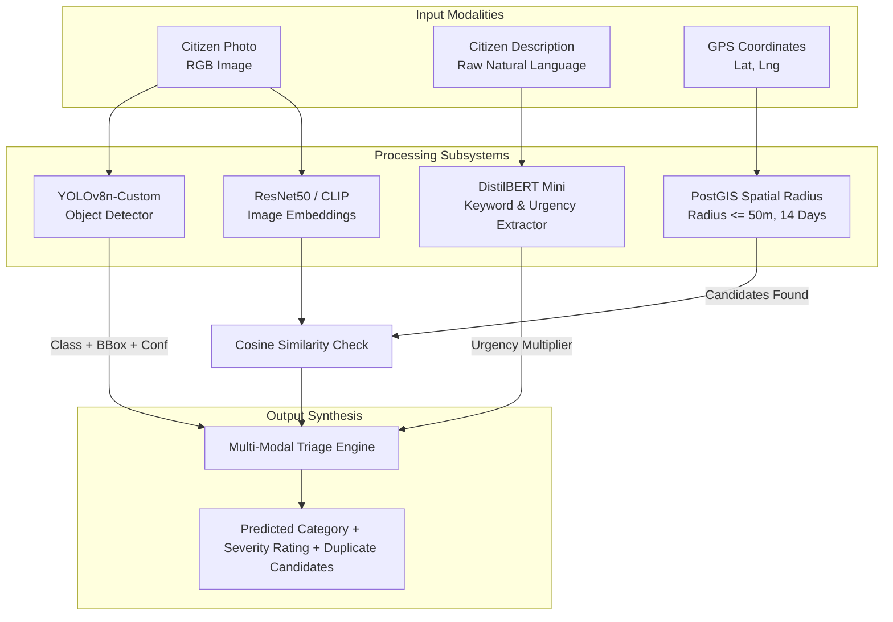
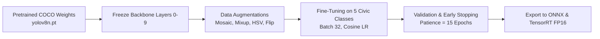
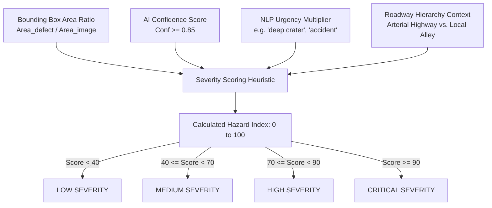
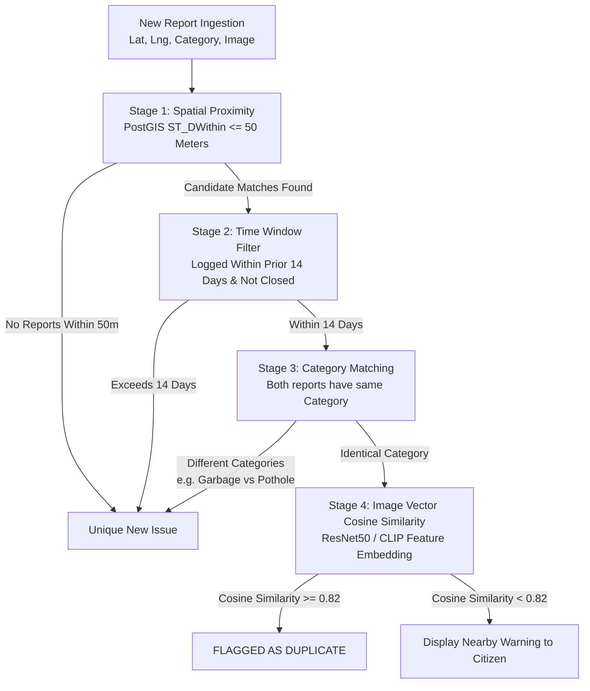

# Document 07 — AI/ML Design and Implementation
## CivicCare: Computer Vision, Natural Language Processing, Spatial Deduplication, and MLOps Pipeline

---

### 1. Document Control & Metadata
- **Document Identifier:** CIVIC-AI-007
- **Status:** Approved AI Engineering Specification
- **Version:** 1.0.0
- **Primary AI Frameworks:** PyTorch 2.2+, Ultralytics YOLOv8, Hugging Face Transformers, OpenCV, ONNX Runtime
- **Inference Runtime:** Python 3.10 / FastAPI / CUDA or High-Performance CPU Container

---

### 2. Problem Formulation & Task Definition

CivicCare formulates civic grievance triage as a **Multi-Modal Decision Task** combining:
1. **Visual Object Detection:** Detecting and localizing physical infrastructure defects within a bounding box $[x_{min}, y_{min}, x_{max}, y_{max}]$ and classifying the primary issue into one of 6 target classes.
2. **Textual Urgency & Intent Extraction:** Parsing natural language descriptions to extract secondary hazard indicators (e.g., "sparking", "flooding", "traffic blocked", "deep").
3. **Spatial-Temporal Image Deduplication:** Determining whether a newly reported defect is identical to an active open incident logged within a 50-meter radius over the prior 14 days.



---

### 3. Model Architecture Selection: Object Detection vs. Classification

The prompt mandates evaluating **YOLO Object Detection** vs. **Standard Image Classification** across all 6 civic categories.

| Civic Category | Object Detection (YOLOv8) Suitability | Pure Image Classification (ResNet/EfficientNet) Suitability | Architectural Decision & Rationale |
| :--- | :--- | :--- | :--- |
| **Pothole** | **Superior.** Accurately localizes the crater against the asphalt road canvas; bounding box area allows estimating defect surface percentage. | Weak. Tends to overfit on background road texture, street signs, or car tires rather than the cavity itself. | **YOLOv8 Object Detection.** Bounding box confirms model attended to the actual defect. |
| **Broken Road / Cracks** | **Superior.** Detects elongated fractures, asphalt caving, and edge collapse. | Moderate. Can detect rough texture, but fails to distinguish intentional road seams from hazardous structural failures. | **YOLOv8 Object Detection.** |
| **Streetlight** | **Superior.** Identifies pole fixtures, broken luminaire glass, hanging casing, or exposed ground junction boxes. | Very Poor. Streetlight occupies $< 5\%$ of the total sky/street image area. Classification models suffer from background sky dominance. | **YOLOv8 Object Detection.** Crucial for isolating small vertical infrastructure in wide-angle photos. |
| **Garbage Overflow** | **Superior.** Detects dumpster boundaries, scattered refuse bags, and litter piles. | Moderate. Often triggered by unrelated background objects (dumpster color alone). | **YOLOv8 Object Detection.** Distinguishes an overflowing bin from an orderly closed municipal bin. |
| **Water Leak** | **Moderate to Superior.** Identifies surface water pooling, bursting valves, and bubbling pavement. | Weak. Often confused with harmless rainwater puddles or wet asphalt after cleaning. | **YOLOv8 + NLP Fusion.** Visual detection of surface water combined with text NLP keywords ("burst pipe", "leak"). |
| **Others** | Fallback class. | Fallback class. | Default fallback when top model confidence is $< 0.60$. |

**Architectural Choice:** **Ultralytics YOLOv8n (Nano)** fine-tuned on civic defect datasets. YOLOv8 provides state-of-the-art inference latency ($\approx 45\text{ ms}$ on CPU, $< 10\text{ ms}$ on GPU), low parameter footprint ($3.2\text{M}$ parameters), and spatial bounding boxes that provide verifiable visual evidence on the municipal admin dashboard (Screen 10 in `image.png`).

---

### 4. Dataset Sourcing, Annotation, and Quality Engineering

#### 4.1 Data Sourcing & Open Public Datasets

| Dataset Source | Modality / Category | Open License | Sample Volume |
| :--- | :--- | :--- | :--- |
| **RDD2022 (Road Damage Dataset)** | Potholes, longitudinal/transverse cracks, alligator cracking | CC BY-SA 4.0 | 47,000+ annotated street images across India, Japan, USA |
| **TACO (Trash Annotations in Context)** | Waste, plastics, beverage cans, overflowing trash | Open Source MIT | 15,000+ annotations in diverse urban environments |
| **OpenImages v7 (Google)** | Street lamps, light poles, utility fixtures | CC BY 4.0 | 8,500+ localized streetlight instances |
| **MIMII / Custom Water Leak Corpus** | Gushing water, ruptured utility valves, urban water pooling | Custom Municipal Archive | 3,200 curated municipal images |

#### 4.2 Data Cleansing, Normalization & Quality Checks
1. **De-duplication:** Perceptual hashing (pHash) applied across raw training scrapes to remove identical duplicate images.
2. **Blur / Defocus Screening:** Laplacian variance algorithm checks sharpness. Images with $\sigma^2 < 100.0$ are flagged as motion-blurred and filtered or sent to a synthetic augmentation branch.
3. **Exposure Normalization:** Histogram equalization balances extreme night shadows and noon sun glare.

#### 4.3 Stratified Data Splitting
The unified dataset of approximately 35,000 curated images is partitioned into:
- **Training Set (70%):** 24,500 images (stratified by class distribution).
- **Validation Set (15%):** 5,250 images (used for hyperparameter tuning and early stopping).
- **Test Set (15%):** 5,250 images (held-out test set for final performance benchmarking).

---

### 5. Training Pipeline & Hyperparameters



#### Training Configuration:
- **Base Architecture:** YOLOv8n (3.2M parameters) pretrained on MS-COCO.
- **Input Resolution:** $640 \times 640 \times 3$.
- **Batch Size:** 32 (on NVIDIA A10G 24GB VRAM) or 16 (on local RTX 4090).
- **Optimizer:** AdamW ($\beta_1 = 0.937, \beta_2 = 0.999$, weight decay $= 0.0005$).
- **Learning Rate:** Initial $\eta_0 = 0.001$ with Cosine Annealing learning rate schedule decaying to $1e-5$.
- **Loss Formulation:** Complete Intersection over Union (CIoU) bounding box loss + Binary Cross Entropy (BCE) classification loss with Focal Loss modulation ($\gamma = 1.5$) to counter class imbalance.
- **Augmentation Pipeline:** Mosaic ($p = 1.0$, disabled last 10 epochs), Mixup ($p = 0.15$), HSV color space jitter ($h = 0.015, s = 0.7, v = 0.4$), random horizontal flip ($p = 0.5$).

---

### 6. Natural Language Processing (NLP) Description Pipeline

While computer vision identifies visual physical defects, the textual description submitted by the citizen (up to 300 characters) provides vital context:
1. **Keyword & Entity Extraction:** A lightweight rule and token parser (spaCy / DistilBERT) identifies high-hazard keywords:
   - High Urgency: `"sparking"`, `"fire"`, `"deep"`, `"accident"`, `"overflowing"`, `"burst"`, `"traffic halted"`, `"ambulance blocked"`.
2. **Intent Classification:** Verifies that the citizen's report describes a genuine civic infrastructure issue rather than spam, commercial advertising, or personal grievances.
3. **Sentiment & Urgency Scoring:** Assigns an urgency multiplier $U_{text} \in [1.0, 1.5]$ that contributes to the severity estimation heuristic.

---

### 7. Severity Estimation Engine & Operational Separation

> [!CRITICAL]
> **Strict Operational Rule:** AI model confidence is NOT physical safety risk! A high model confidence ($0.98$) simply means the algorithm is certain the image depicts a pothole; it does not inherently mean the pothole is a mortal danger. Severity estimation is a distinct multi-factor heuristic calculation.



#### Hazard Index Formula:
$$\text{Hazard Index} = \left( w_1 \cdot \text{BBoxAreaRatio} + w_2 \cdot U_{text} + w_3 \cdot \text{RoadTier} \right) \times 100$$
- If an open manhole or sparking streetlight junction is identified on a Primary Arterial Highway (high vehicle speed), the score automatically escalates to `CRITICAL`.
- All calculated severities are displayed as **proposals**; municipal supervisors retain full authority to override the rating in Screen 10 of the Web Dashboard.

---

### 8. Multi-Stage Duplicate Detection Pipeline

Spatial proximity alone is insufficient for duplicate detection: a busy municipal crossroads can simultaneously suffer from a pothole, a broken streetlight on the corner, and an overflowing garbage bin across the lane. All three share the exact same GPS coordinates, but represent distinct problems requiring different departments.

CivicCare enforces a **4-Stage Funnel for Duplicate Screening**:



#### Image Vector Similarity:
- Images are passed through a lightweight backbone (ResNet50 or MobileNetV3 feature extractor) producing a 512-dimensional vector embedding.
- Cosine similarity between candidate vectors is evaluated:
$$\text{Sim}(v_1, v_2) = \frac{v_1 \cdot v_2}{\|v_1\| \|v_2\|}$$
- If $\text{Sim} \ge 0.82$, confidence of an exact physical duplicate is high. The system triggers Screen 11 (Duplicate Warning Modal) on the mobile client.

---

### 9. FastAPI AI Service Implementation Contract

```python
# FastAPI Microservice Schema Contract
from pydantic import BaseModel, Field
from typing import List, Optional

class InferenceRequest(BaseModel):
    storage_path: str = Field(..., description="Supabase S3 storage path of the uploaded image")
    description: str = Field(..., max_length=300, description="Citizen text description")
    latitude: float = Field(..., ge=-90.0, le=90.0)
    longitude: float = Field(..., ge=-180.0, le=180.0)

class BoundingBox(BaseModel):
    box_2d: List[float] = Field(..., description="[ymin, xmin, ymax, xmax] normalized coordinates")
    label: str
    confidence: float

class InferenceResponse(BaseModel):
    category_predicted: str
    confidence: float
    severity_estimated: str
    bounding_boxes: List[BoundingBox]
    nlp_urgency_score: float
    flagged_uncertain: bool
    inference_latency_ms: float
```

---

### 10. MLOps: Model Versioning, Drift Detection, and Retraining

1. **Artifact Registry:** Model weights (`yolov8n_civiccare_v1.onnx`) are registered and version-controlled via MLflow with immutable checksums and evaluation benchmark manifests.
2. **Data Flywheel:** Every report where a citizen or supervisor manually overrides the AI classification is logged into a `flagged_for_retraining` dataset.
3. **Data Drift Monitoring:** A weekly scheduled job runs Kolmogorov-Smirnov distribution tests on incoming image luminance, contrast, and category prediction ratios to detect seasonal drift (e.g., increased potholes during monsoon season).
4. **Retraining Frequency:** Monthly active retraining cadence triggered when at least 1,000 verified human-corrected edge cases are accumulated.

---
*Next Document: [Document 08 — Use Cases and Business Rules](file:///d:/SOURCE%20CODE/BUSINESS/CIVIC%20CARE/docs/08_USE_CASES_AND_BUSINESS_RULES.md)*
