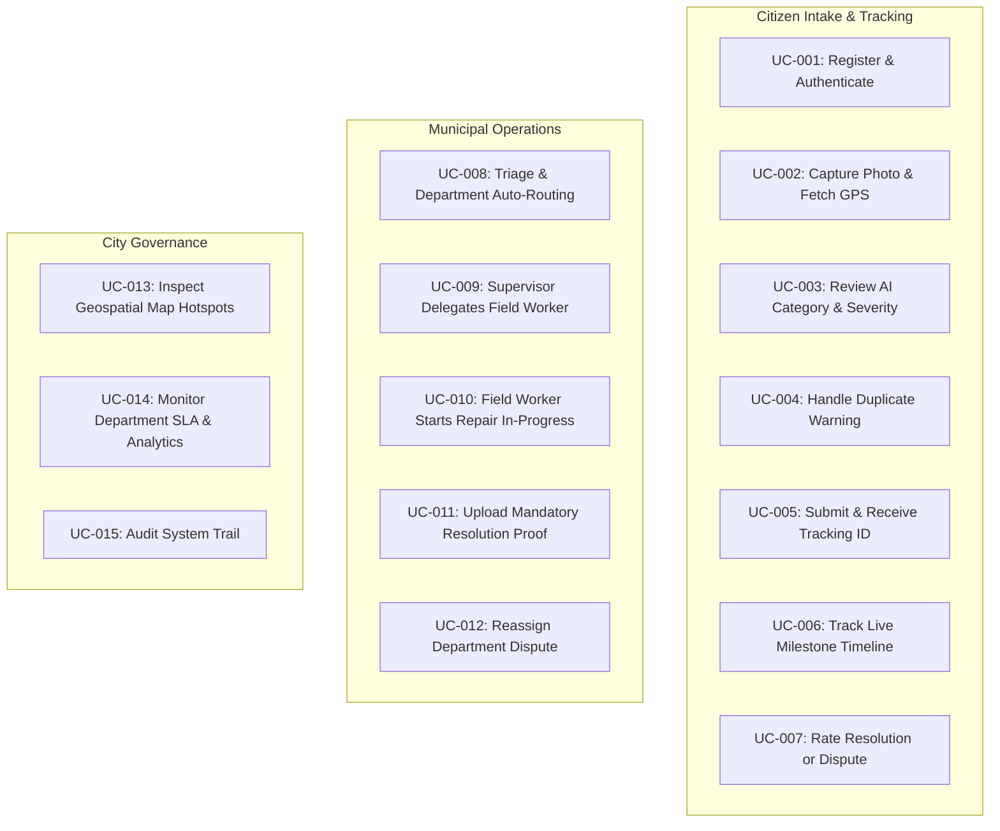

# Document 08 — Use Cases and Business Rules
## CivicCare: Comprehensive Use Case Catalogue, Authorization Matrix, and Operational Governance Rules

---

### 1. Document Control & Metadata
- **Document Identifier:** CIVIC-UC-008
- **Status:** Approved Functional & Governance Specification
- **Version:** 1.0.0
- **Scope:** Complete user interactions, preconditions, alternative branches, and operational business rules governing the CivicCare ecosystem.

---

### 2. Ecosystem Role Permissions Matrix (RBAC)

The table below defines granular authorization rights across the 4 primary user roles:
- **CITIZEN (`C`)**
- **FIELD_WORKER (`FW`)**
- **DEPT_SUPERVISOR (`DS`)**
- **SUPER_ADMIN (`SA`)**

| Feature / Operation | CITIZEN | FIELD_WORKER | DEPT_SUPERVISOR | SUPER_ADMIN | Enforced Layer |
| :--- | :---: | :---: | :---: | :---: | :--- |
| Create Civic Report | **CREATE** | — | — | — | PostgreSQL RLS / API Gateway |
| View Public Reports Map | **READ** | **READ** | **READ** | **READ** | Public / Spatial Index |
| Override AI Category on Submit | **EXECUTE** | — | — | — | Mobile UI Client & API |
| Override Category after Intake | — | — | **UPDATE** | **UPDATE** | Admin Web Drawer / API |
| View Unredacted Citizen Phone/Email | — | — | **READ** | **READ** | PostgreSQL RLS |
| Reassign Department | — | — | **UPDATE** | **UPDATE** | Admin Web Drawer / API |
| Delegate Ticket to Field Worker | — | — | **UPDATE** | **UPDATE** | Admin Web Drawer / API |
| Transition to `IN_PROGRESS` | — | **UPDATE** | **UPDATE** | **UPDATE** | Admin Web / Mobile Staff |
| Upload Resolution Photo Proof | — | **CREATE** | **CREATE** | **CREATE** | Storage Policy / API |
| Transition to `RESOLVED` | — | **UPDATE** | **UPDATE** | **UPDATE** | API Verification Rule |
| Dispute / Reopen Resolved Ticket | **UPDATE** | — | — | — | API Verification ($\le 48$h) |
| Rate Resolution Quality (CSAT) | **CREATE** | — | — | — | PostgreSQL RLS |
| Access Citywide Analytics & KPIs | — | — | **READ** (Dept) | **READ** (City) | Admin Web / API |
| Manage Department Headcount | — | — | — | **FULL** | Admin Web / API |
| Inspect Immutable Audit Logs | — | — | — | **READ** | PostgreSQL RLS |

---

### 3. Comprehensive Use Case Catalogue

---

#### UC-001: Citizen Registration & Authentication
- **Use Case ID:** UC-001
- **Actor:** Citizen
- **Preconditions:** Citizen has installed the CivicCare mobile application and has cellular connectivity.
- **Trigger:** Citizen taps `"Get Started"` on Splash Screen or `"Sign In"`.
- **Main Flow:**
  1. Citizen enters 10-digit mobile phone number.
  2. System validates format and dispatches 6-digit SMS One-Time Password (OTP).
  3. Citizen enters OTP in the 6-cell verification input.
  4. System verifies OTP via Supabase Auth GoTrue service.
  5. System creates or fetches citizen profile in `public.profiles`.
  6. Citizen is authenticated and navigated to the Home Dashboard.
- **Alternative Flow (OAuth):** Citizen taps `"Continue with Google"`. System opens OAuth sheet, verifies identity, and provisions profile.
- **Exceptions:** Invalid OTP entered 3 times; system locks submission for 5 minutes.
- **Postconditions:** Valid JWT session stored in encrypted device storage (`SecureStore`).

---

#### UC-002: Capture Civic Defect with Photo and Hardware GPS
- **Use Case ID:** UC-002
- **Actor:** Citizen
- **Preconditions:** Citizen is authenticated and within municipal boundary.
- **Trigger:** Citizen taps prominent blue `Report an Issue` button on Home Dashboard.
- **Main Flow:**
  1. System checks camera and location hardware permissions.
  2. Viewfinder opens; citizen snaps photo of road defect or overflowing waste.
  3. System initiates hardware GPS fix, obtaining latitude, longitude, and horizontal accuracy ($\le 15\text{m}$).
  4. System calls reverse-geocoding service to resolve coordinates into human-readable street address (e.g., `"MG Road, Andheri West, Mumbai"`).
  5. System presents photo preview with auto-detected address on Screen 4.
- **Alternative Flow (GPS Drifting):** Horizontal accuracy exceeds 25 meters. System highlights the location pin in yellow and allows citizen to tap `"Change"` to refine pin on interactive map.
- **Exceptions:** Citizen permanently denies camera permission. System displays explanatory modal with deep link to OS Settings.

---

#### UC-003: Asynchronous AI Review & Category Confirmation
- **Use Case ID:** UC-003
- **Actor:** Citizen / System AI Engine
- **Preconditions:** Photo and GPS captured; citizen entered brief text description.
- **Trigger:** Citizen taps `"Submit Report"` on Screen 4.
- **Main Flow:**
  1. Client uploads image to temporary cloud storage via pre-signed URL.
  2. Client renders Screen 5 (AI Analysis) with animated checklist:
     - `[✓] Image analysis`
     - `[✓] Text analysis`
     - `[⟳] Detecting category`
     - `[○] Estimating severity`
     - `[○] Finding similar reports`
  3. FastAPI microservice executes YOLOv8 object detection and DistilBERT urgency parsing.
  4. Returns detected class: `POTHOLE`, confidence: `0.94`, severity: `HIGH`.
  5. Screen 6 displays the detected category with an option to confirm or override.
- **Alternative Flow (Low Confidence $< 0.60$):** Model is uncertain due to poor lighting or blur. System flags category as `OTHERS` and prompts citizen: *"We couldn't clearly identify the defect. Please tap to select the category manually."*

---

#### UC-004: Intercept Spatial-Temporal Duplicate Complaints
- **Use Case ID:** UC-004
- **Actor:** Citizen
- **Preconditions:** Issue category and GPS coordinates known.
- **Trigger:** AI analysis initiates spatial duplicate lookup against active database records.
- **Main Flow:**
  1. System executes PostGIS query: `find_duplicate_reports(lat, lng, category_id, radius=50m, days=14)`.
  2. Identifies active ticket `#CC20241010` located 22 meters away logged 4 hours prior.
  3. System presents Screen 11 (Duplicate Warning Modal) displaying side-by-side comparison of existing report photo and citizen's newly snapped photo.
  4. Citizen selects `"Upvote & Track Existing"`.
  5. System increments `subscriber_count` on existing ticket `#CC20241010` and subscribes citizen's user ID to push alerts.
  6. Citizen is redirected to tracking timeline for `#CC20241010` without creating redundant database records.
- **Alternative Flow (Citizen Insists on Distinct Issue):** Citizen taps `"Submit New Report Anyway"` (e.g., two distinct potholes 10 meters apart). System creates new independent ticket and flags it with `duplicate_override = true` for supervisor review.

---

#### UC-005: Final Submission & Unique Tracking ID Generation
- **Use Case ID:** UC-005
- **Actor:** Citizen / System API
- **Preconditions:** Citizen confirms category and location; duplicate check passed or dismissed.
- **Trigger:** Citizen confirms final submission.
- **Main Flow:**
  1. Mobile app dispatches `POST /api/v1/reports`.
  2. Database assigns a unique human-readable tracking ticket: `#CC` + `YYYYMMDD` + 4-digit sequence (e.g., `#CC20241026`).
  3. System creates initial timeline entry in `report_status_history` (`SUBMITTED`).
  4. System executes rule-based auto-routing, linking report to `Road Maintenance Department`.
  5. Mobile app renders Screen 6 (Report Submitted) with green checkmark, copyable `#CC20241026` ticket badge, and `"Track This Report"` CTA.

---

#### UC-006: Real-Time Milestone Tracking & Push Notifications
- **Use Case ID:** UC-006
- **Actor:** Citizen
- **Preconditions:** Citizen has submitted at least one active ticket.
- **Trigger:** Citizen opens `"Track This Report"` or taps a push notification alert.
- **Main Flow:**
  1. App connects to Supabase Realtime channel `report:#CC20241026`.
  2. Renders vertical chronological timeline (Screen 7 in `image.png`):
     - `Report Submitted` (Completed Oct 26, 10:30 AM)
     - `AI Classification` (Completed Oct 26, 10:31 AM — High Severity)
     - `Sent to Road Maintenance Dept.` (Completed Oct 26, 10:35 AM)
     - `In Progress` (Active pulsating badge — Oct 26, 2:15 PM)
     - `Resolved` (Pending)
  3. When municipal staff transitions state in web dashboard, database trigger broadcasts WAL event over WebSocket.
  4. Mobile app immediately updates the active milestone indicator without page reload.

---

#### UC-007: Department Supervisor Triage & Field Crew Assignment
- **Use Case ID:** UC-007
- **Actor:** Department Supervisor (Road Maintenance Dept)
- **Preconditions:** Supervisor logged into Municipal Web Dashboard (Screen 8 in `image.png`).
- **Trigger:** Incoming ticket arrives in Department queue.
- **Main Flow:**
  1. Supervisor navigates to `"Reports"` table or `"Map View"`.
  2. Clicks red High-Severity pin in Andheri West, opening the Report Details Drawer (Screen 10 in `image.png`).
  3. Inspects high-resolution photo, AI bounding box, and citizen description.
  4. Verifies category `Pothole` and severity `High`.
  5. Selects field technician `"John D'souza"` from the `"Assigned To"` dropdown.
  6. Changes status dropdown to `"In Progress"`.
  7. Enters internal remarks: *"Work started. Expected completion in 2 days."*
  8. Taps blue button `"Update Report"`.
  9. System updates database, creates audit record, and triggers mobile push alert to citizen.

---

#### UC-008: Mandatory Resolution Evidence & Ticket Closure
- **Use Case ID:** UC-008
- **Actor:** Field Worker / Department Supervisor
- **Preconditions:** Physical asphalt repair completed on site; ticket is currently `IN_PROGRESS`.
- **Trigger:** Supervisor opens ticket to finalize resolution.
- **Main Flow:**
  1. Supervisor clicks `"Resolve Issue"`.
  2. System opens Resolution Modal requiring post-repair photographic proof.
  3. Supervisor uploads clear photo of the newly patched road surface.
  4. System validates file upload, stores in `resolution_evidence`, and updates status to `RESOLVED`.
  5. System starts a 48-hour citizen dispute window timer.
  6. Citizen receives notification: *"Issue #CC20241026 has been Resolved! Please inspect and rate our work."*
- **Alternative Flow (Citizen Disputes Closure):** Within 48 hours, citizen inspects site, finds pothole inadequately patched, and taps `"Dispute & Reopen"` in app, uploading a new photo. Status transitions to `REOPENED` and supervisor is alerted.
- **Alternative Flow (Auto-Closure):** 48 hours elapse without citizen dispute. System automatically transitions ticket to `CLOSED`.

---

#### UC-009: Inter-Departmental Reassignment Dispute
- **Use Case ID:** UC-009
- **Actor:** Department Supervisor
- **Preconditions:** Ticket was misrouted or involves multi-departmental jurisdictional overlap.
- **Trigger:** Supervisor inspects ticket and identifies root cause belongs to another department.
- **Main Flow:**
  1. Road Maintenance supervisor inspects report for a road crater and observes an active ruptured clean water utility line flooding the asphalt.
  2. Supervisor selects `"Reassign Department"` in Screen 10.
  3. Selects `"Water Supply & Sewerage Department"`.
  4. Enters mandatory transfer remark: *"Road erosion caused by major underground pipeline burst. Water supply crew must isolate leak before road resurfacing can occur."*
  5. System reassigns `department_id`, logs transfer in `audit_logs`, and notifies Water Supply supervisor.

---

### 4. Comprehensive Business Rules (BR-001 through BR-015)

- **BR-001 (Category to Department Mapping):**
  Complaints are deterministically routed to the responsible municipal department based on verified category:
  - `POTHOLE`, `BROKEN_ROAD` $\rightarrow$ Road Maintenance Department
  - `GARBAGE` $\rightarrow$ Solid Waste Management Department
  - `STREETLIGHT` $\rightarrow$ Electrical & Public Lighting Department
  - `WATER_LEAK` $\rightarrow$ Water Supply & Sewerage Department
  - `OTHERS` $\rightarrow$ Central Civic Grievance Triage Cell
- **BR-002 (Geospatial Fencing Boundary):**
  Submissions must fall within the officially registered municipal corporation polygon boundary (e.g., MCGM Greater Mumbai GeoJSON). Out-of-boundary submissions are rejected at intake with explicit geographic guidance.
- **BR-003 (Mandatory Photographic Evidence):**
  No citizen report may be submitted without at least 1 verified camera image. No ticket may transition to `RESOLVED` without at least 1 verified post-repair photograph in `resolution_evidence`.
- **BR-004 (Duplicate Candidate Spatio-Temporal Radius):**
  Reports filed within $\le 50.0\text{ meters}$ of an active (non-closed) complaint of the same category within the prior 14 days must trigger the Duplicate Interception Modal.
- **BR-005 (Citizen Dispute SLA Window):**
  Citizens have exactly 48 hours from the timestamp of `RESOLVED` status notification to contest the resolution. After 48 hours, the ticket transitions permanently to `CLOSED`.
- **BR-006 (Role Elevation Prevention):**
  Citizen accounts can never modify their own role attribute. Any API payload containing role escalation attempts triggers an immediate security alert and token revocation.
- **BR-007 (Audit Trail Immutability):**
  Records in `public.audit_logs` are strictly append-only. No user, including `SUPER_ADMIN`, possesses database permissions to execute `UPDATE` or `DELETE` against audit records.
- **BR-008 (AI Inference Fallback SLA):**
  If AI inference fails or times out ($> 3.0\text{ seconds}$), the ticket defaults to status `SUBMITTED`, category `OTHERS`, and is marked with `ai_flagged_uncertain = true` for immediate human triage.
- **BR-009 (Rate Limiting & Abuse Throttling):**
  A single citizen account is throttled to a maximum of 5 report submissions per rolling hour to prevent malicious flooding or denial-of-service attempts.
- **BR-010 (Emergency Escalation for Critical Severity):**
  Tickets classified as `CRITICAL` (e.g., open deep manholes, sparking live wires) bypass standard batching and immediately trigger SMS and push alerts to on-duty emergency supervisors.

---
*Next Document: [Document 09 — Security, Privacy, and Abuse Prevention](file:///d:/SOURCE%20CODE/BUSINESS/CIVIC%20CARE/docs/09_SECURITY_PRIVACY_AND_ABUSE_PREVENTION.md)*
