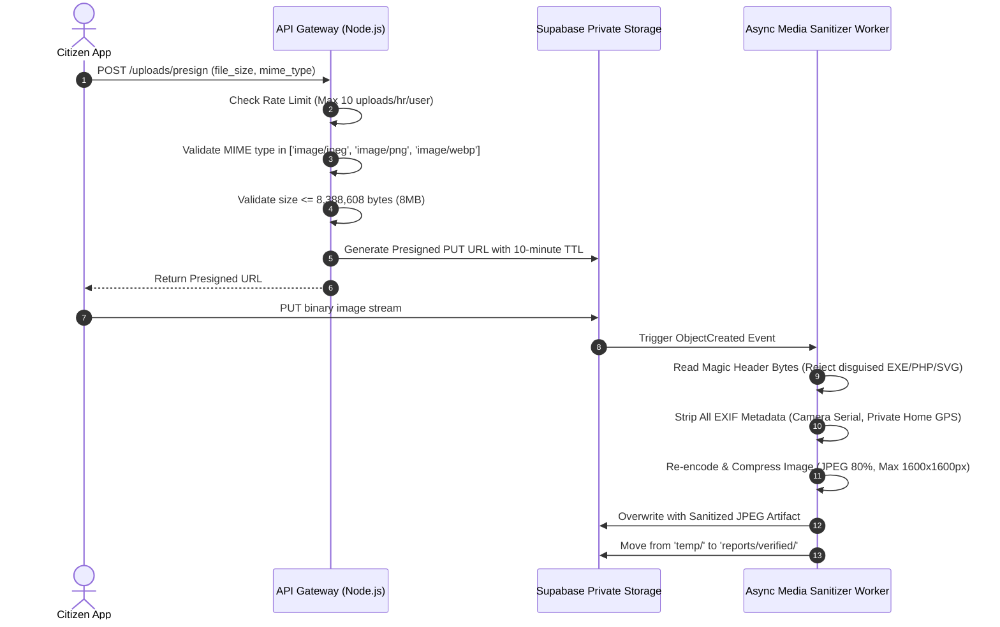
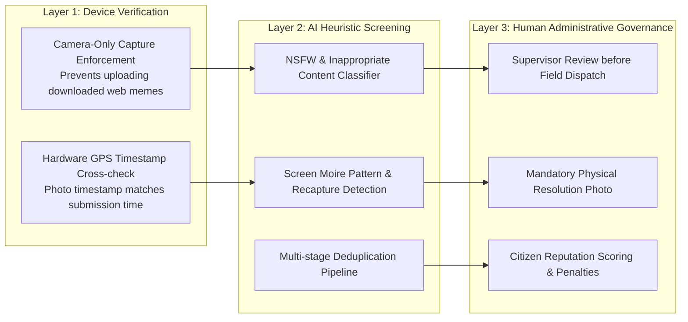

# Document 09 — Security, Privacy, and Abuse Prevention
## CivicCare: Information Security, Zero-Trust Architecture, Data Privacy, and Threat Modeling

---

### 1. Document Control & Metadata
- **Document Identifier:** CIVIC-SEC-009
- **Status:** Approved Security & Compliance Specification
- **Version:** 1.0.0
- **Regulatory Frameworks:** India Digital Personal Data Protection Act (DPDP 2023), ISO/IEC 27001, OWASP Top 10 (2021), OWASP API Security Top 10 (2023)

---

### 2. Threat Modeling & Attack Surface Analysis (STRIDE)

CivicCare handles crowd-sourced public submissions, geographic coordinate data, and government municipal workflows. The system is hardened against adversarial manipulation using the STRIDE threat model:

```mermaid
graph TD
    subgraph "STRIDE Threat Vectors"
        S[Spoofing Identity<br/>Forged Citizen/Admin Accounts]
        T[Tampering with Data<br/>Manipulated Photos & Fake Reports]
        R[Repudiation<br/>Field Staff denying task assignment]
        I[Information Disclosure<br/>Citizen PII & Private Coordinates Leaked]
        D[Denial of Service<br/>Image upload bombing & GPS flooding]
        E[Elevation of Privilege<br/>Citizen escalating to Super Admin]
    end

    subgraph "CivicCare Security Mitigations"
        M_S[Supabase Auth JWT + SMS OTP + MFA for Admins]
        M_T[EXIF Validation, Content Hashes, Mandatory Supervisor Sign-off]
        M_R[Append-Only Immutable PostgreSQL Audit Logs]
        M_I[PostgreSQL RLS, Redacted PII, Ephemeral 15m Signed URLs]
        M_D[Cloudflare WAF, Presigned S3 Uploads, Rate Limiter 5/hr]
        M_E[Database-level ENUM constraints, RLS current_user_role()]
    end

    S --> M_S
    T --> M_T
    R --> M_R
    I --> M_I
    D --> M_D
    E --> M_E
```

---

### 3. Image Ingestion Security & Media Sanitization Pipeline

Public media upload funnels represent the primary attack vector for Remote Code Execution (RCE), Server-Side Request Forgery (SSRF), and denial-of-service via storage exhaustion.



#### Media Hardening Controls:
1. **Magic Number Header Validation:** Before processing, the worker inspects the initial byte signatures:
   - JPEG: `FF D8 FF`
   - PNG: `89 50 4E 47 0D 0A 1A 0A`
   - WebP: `52 49 46 46 ... 57 45 42 50`
   Any file failing magic byte inspection is immediately deleted.
2. **SVG & Executable Rejection:** Scalable Vector Graphics (SVG) files are strictly rejected to eliminate Stored Cross-Site Scripting (XSS) vectors.
3. **EXIF Privacy Sanitization:** Photographs captured on smartphones often embed intimate metadata (device serials, camera owner name, historical home coordinates). The sanitization worker strips all EXIF metadata except basic orientation before storage.
4. **Isolated Private Storage:** The storage bucket `report-images` has public access completely disabled. Files can only be retrieved using short-lived signed URLs ($\text{TTL} = 15\text{ minutes}$) generated on demand by authorized API requests.

---

### 4. Malicious Uploads & False Complaint Mitigation

> [!WARNING]
> **Engineering Reality:** AI alone cannot reliably determine whether a photograph represents a genuine municipal emergency or a malicious staging (e.g., photo of a photo on a computer screen, a downloaded internet image, or an old photo submitted out of spite). CivicCare relies on **Defense-in-Depth**.



#### Anti-Abuse Heuristics:
1. **Camera-Preferred Capture:** Mobile application defaults to launching the live native camera hardware viewfinder, preventing citizens from bulk-uploading old downloaded internet memes.
2. **Citizen Trust Score:** Every registered profile tracks an internal reliability score ($0.0\text{ to }1.0$). If a citizen repeatedly files rejected reports or non-civic spam, their account is throttled and flagged for mandatory manual review before reaching department queues.
3. **Account Throttling:** Maximum 5 reports per rolling hour per phone number.
4. **Geographic Fencing Rejection:** Any coordinate falling outside the official municipal polygon (e.g., coordinates in the Arabian Sea or outside Greater Mumbai) is rejected immediately at the API gateway layer.

---

### 5. Personal Data Protection & Privacy Governance (DPDP Compliance)

Under modern privacy regulations, citizen grievance reports must safeguard personal identifiable information (PII):

#### 5.1 PII Minimization Architecture
- **Public Map Anonymization:** On the public "Nearby Issues Map" (Screen 16), the reporting citizen's name, phone number, and avatar are strictly omitted from the API payload. The report appears anonymously as: *"Reported by a Resident • 2 hours ago"*.
- **Field Worker View Masking:** Field maintenance workers (asphalt repair crews) see only the defect location, photos, and issue description. The citizen's phone number is masked (`+91 98765*****`) to prevent harassment.
- **Selective Supervisor Access:** Only verified Department Supervisors (`DEPT_SUPERVISOR`) and `SUPER_ADMIN` have authorization to view unmasked citizen contact details for urgent on-site clarifications.

#### 5.2 Right to Erasure & Account Deletion
- In compliance with privacy statutes, citizens can request complete account deletion via `DELETE /api/v1/profiles/me`.
- Upon deletion:
  - Personal identity fields (`full_name`, `phone_number`, `email`, `avatar_url`) in `public.profiles` are permanently overwritten with anonymous hashes (`deleted_user_xyz@civiccare.local`).
  - Historical infrastructure defect tickets (`public.reports`) are retained for municipal infrastructure longevity analysis, but all foreign key links to the citizen's personal identity are severed.

---

### 6. Secrets Management & Zero-Trust Protocol

1. **Zero Secret Hardcoding:** No database passwords, Supabase Service Role keys, Twilio auth tokens, or private encryption keys are committed to Git repositories.
2. **Environment Variable Isolation:** Secrets are injected at runtime via encrypted environment secret stores (AWS Secrets Manager / Vercel Environment Variables).
3. **Client-Side Key Hygiene:** The React Native mobile app and React web dashboard bundles contain **only** public keys:
   - `EXPO_PUBLIC_SUPABASE_URL`
   - `EXPO_PUBLIC_SUPABASE_ANON_KEY`
   The high-privilege `SUPABASE_SERVICE_ROLE_KEY` is restricted strictly to backend container environments and is never shipped in client code.
4. **mTLS for Internal AI Microservices:** Communications between the Node.js API Gateway and the Python FastAPI AI service operate over an internal private Docker network with pre-shared bearer token authentication (`X-Internal-Service-Key`).

---

### 7. Immutable Audit Logging Architecture

Every security-sensitive event is automatically written to the `public.audit_logs` table via database triggers:
- User login / authentication events
- Department reassignments
- Status transitions (`SUBMITTED` $\rightarrow$ `IN_PROGRESS` $\rightarrow$ `RESOLVED`)
- AI category overrides
- Manual report rejections

```sql
-- Security Trigger: Prevent modification or deletion of audit logs
CREATE OR REPLACE FUNCTION public.enforce_audit_immutability()
RETURNS TRIGGER AS $$
BEGIN
    RAISE EXCEPTION 'Audit logs are immutable. UPDATE or DELETE operations are strictly forbidden.';
    RETURN NULL;
END;
$$ LANGUAGE plpgsql;

CREATE TRIGGER trg_protect_audit_logs
    BEFORE UPDATE OR DELETE ON public.audit_logs
    FOR EACH ROW EXECUTE FUNCTION public.enforce_audit_immutability();
```

---

### 8. Disaster Recovery, Backups & Business Continuity

| Backup Tier | Mechanism | Frequency | Retention Window | Recovery Time Objective (RTO) | Recovery Point Objective (RPO) |
| :--- | :--- | :--- | :--- | :--- | :--- |
| **Point-in-Time Recovery (PITR)** | PostgreSQL WAL Archiving | Continuous (Every 2 minutes) | 7 Days | $< 30\text{ minutes}$ | $\le 2\text{ minutes}$ |
| **Daily Full Snapshots** | Automated Managed Snapshot | Daily at 02:00 UTC | 30 Days | $< 1\text{ hour}$ | $\le 24\text{ hours}$ |
| **Media Storage Replication** | S3 Cross-Region Bucket Mirroring | Asynchronous | 90 Days | $< 15\text{ minutes}$ | Near real-time |

---
*Next Document: [Document 10 — Testing and Quality Assurance](file:///d:/SOURCE%20CODE/BUSINESS/CIVIC%20CARE/docs/10_TESTING_AND_QUALITY_ASSURANCE.md)*
