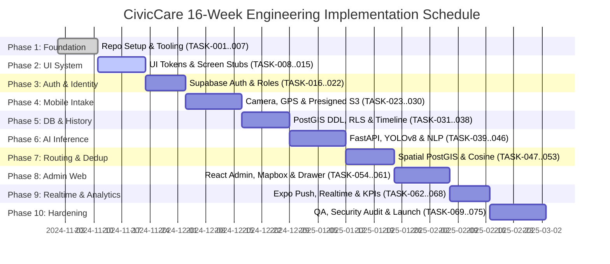

# Document 11 — Development Roadmap and Task Breakdown
## CivicCare: 10-Phase Implementation Roadmap, Work Breakdown Structure (WBS), and Milestone Milestones

---

### 1. Document Control & Metadata
- **Document Identifier:** CIVIC-DEV-011
- **Status:** Approved Engineering Execution Plan
- **Version:** 1.0.0
- **Total Implementation Horizon:** 16 Weeks (Phased Rollout)
- **Methodology:** Agile / 2-Week Sprints with Continuous Delivery

---

### 2. High-Level Milestone Timeline & Gantt Chart

---

### 3. Detailed Phase Breakdown & Task Inventory

#### Phase 1: Requirements, Monorepo & Infrastructure Setup (Weeks 1–2)
- **Phase Objective:** Establish unified Turborepo workspace, Docker development containers, linting, and CI pipelines.
- **Prerequisites:** Approved documentation package (Documents 01–15).
- **Deliverables:** Operational Turborepo structure with shared TypeScript packages and linting configs.

| Task ID | Task Description | Deliverable / Artifact | Dependencies | Priority |
| :--- | :--- | :--- | :--- | :--- |
| **TASK-001** | Initialize Turborepo monorepo with pnpm workspaces | Monorepo root, `package.json`, `pnpm-workspace.yaml` | None | P0 |
| **TASK-002** | Scaffold React Native Expo 51 project in `apps/mobile` | Expo application boilerplate with TypeScript | TASK-001 | P0 |
| **TASK-003** | Scaffold React 18 / Vite project in `apps/admin` | React SPA boilerplate with Tailwind CSS | TASK-001 | P0 |
| **TASK-004** | Scaffold Node.js 20 Express gateway in `apps/api` | Express service with routing skeleton | TASK-001 | P0 |
| **TASK-005** | Scaffold Python 3.10 FastAPI service in `apps/ai-service` | FastAPI boilerplate with Uvicorn and Dockerfile | TASK-001 | P0 |
| **TASK-006** | Setup shared TypeScript types library in `packages/types` | Shared interfaces, DTOs, and status enums | TASK-001 | P0 |
| **TASK-007** | Configure GitHub Actions CI workflow (linting, type-check) | `.github/workflows/ci.yml` | TASK-001..006 | P1 |

---

#### Phase 2: UI Foundation, Design System & Navigation (Weeks 2–3)
- **Phase Objective:** Implement design tokens, typography, and atomic components based on `image.png`.
- **Deliverables:** Complete mobile and web design systems with accessible navigation stacks.

| Task ID | Task Description | Deliverable / Artifact | Dependencies | Priority |
| :--- | :--- | :--- | :--- | :--- |
| **TASK-008** | Implement mobile design tokens in `packages/ui` (colors, spacing) | `theme.ts`, color palette matching `image.png` | TASK-006 | P0 |
| **TASK-009** | Build reusable Button, Input, Card, and Badge components | Atomic UI component library | TASK-008 | P0 |
| **TASK-010** | Configure Expo Router / React Navigation tabs and stack | Mobile navigation structure (Tabs: Home, Reports, Map, Profile) | TASK-002 | P0 |
| **TASK-011** | Build Splash Screen (Screen 1 in `image.png`) | Brand intro view with CTA links | TASK-009 | P1 |
| **TASK-012** | Build Onboarding Walkthrough (Screen 2 in `image.png`) | 3-slide interactive onboarding carousel | TASK-009 | P1 |
| **TASK-013** | Build Mobile Home Dashboard layout (Screen 3 in `image.png`) | Header, city banner, report CTA, 6-category grid | TASK-009 | P0 |
| **TASK-014** | Configure Tailwind CSS & Radix UI primitives for Admin Web | Web styling theme tokens matching Screen 8 in `image.png` | TASK-003 | P0 |
| **TASK-015** | Implement Admin Web responsive layout with sidebar | Admin shell (Sidebar navigation + top bar + header) | TASK-014 | P0 |

---

#### Phase 3: Authentication, Profiles & Role-Based Access (Weeks 4–5)
- **Phase Objective:** Implement Supabase Auth, SMS OTP verification, and RBAC policies.
- **Deliverables:** Secure authentication flows across mobile and web clients.

| Task ID | Task Description | Deliverable / Artifact | Dependencies | Priority |
| :--- | :--- | :--- | :--- | :--- |
| **TASK-016** | Configure Supabase Project & GoTrue Auth settings | Supabase cloud project with Auth schema | TASK-004 | P0 |
| **TASK-017** | Implement `public.profiles` database schema and trigger | Automatic profile creation trigger on user sign-up | TASK-016 | P0 |
| **TASK-018** | Build Mobile Phone Number & SMS OTP Login screen | Verification screen with countdown resend timer | TASK-010, TASK-016 | P0 |
| **TASK-019** | Implement JWT validation middleware in Node.js Gateway | `requireAuth` and `requireRole` middleware | TASK-004, TASK-016 | P0 |
| **TASK-020** | Implement Admin Web Login screen with role verification | Admin login page with error handling | TASK-015, TASK-019 | P0 |
| **TASK-021** | Implement PostgreSQL RLS policies for profiles | User isolation and administrative read access | TASK-017 | P0 |
| **TASK-022** | Build Mobile Profile & Settings screen | Screen 18 (Preferences, phone, language toggle) | TASK-018 | P1 |

---

#### Phase 4: Report Creation, Camera Hardware & GPS (Weeks 5–7)
- **Phase Objective:** Integrate native camera and GPS hardware with direct S3 media uploads.
- **Deliverables:** Functional report capture screen (Screen 4 in `image.png`).

| Task ID | Task Description | Deliverable / Artifact | Dependencies | Priority |
| :--- | :--- | :--- | :--- | :--- |
| **TASK-023** | Integrate `expo-camera` with custom shutter viewfinder | Full-screen camera capture with flash/flip controls | TASK-010 | P0 |
| **TASK-024** | Implement photo preview and deletion controls | Photo thumbnail container with "X" delete button | TASK-023 | P0 |
| **TASK-025** | Integrate `expo-location` for continuous GPS accuracy fix | Hardware GPS service with $\le 15\text{m}$ accuracy filter | TASK-010 | P0 |
| **TASK-026** | Implement reverse-geocoding service (Lat/Lng $\rightarrow$ Street) | Human-readable address resolution hook | TASK-025 | P0 |
| **TASK-027** | Build interactive mini-map location selector with draggable pin | Screen 9 (Address card with "Change" action) | TASK-025 | P0 |
| **TASK-028** | Implement Presigned S3 Upload endpoint in Node.js API | `POST /api/v1/uploads/presign` | TASK-019 | P0 |
| **TASK-029** | Implement direct binary upload streaming in mobile client | Image upload service bypassing Node.js API | TASK-024, TASK-028 | P0 |
| **TASK-030** | Build Issue Description input with 300-char counter | Form validation enforcing $\ge 10$ characters | TASK-009 | P0 |

---

#### Phase 5: Database Entities, Storage & Report History (Weeks 7–8)
- **Phase Objective:** Deploy complete PostgreSQL DDL with PostGIS, RLS, and history tracking.
- **Deliverables:** Database persistence for tickets, images, and chronological status history.

| Task ID | Task Description | Deliverable / Artifact | Dependencies | Priority |
| :--- | :--- | :--- | :--- | :--- |
| **TASK-031** | Execute PostgreSQL migrations for `departments` and `categories` | Seeded municipal departments and category catalog | TASK-017 | P0 |
| **TASK-032** | Execute PostgreSQL migrations for `reports` with PostGIS point | `public.reports` table with GiST spatial index | TASK-031 | P0 |
| **TASK-033** | Execute migrations for `report_images` and `report_status_history` | Media storage metadata and audit timeline tables | TASK-032 | P0 |
| **TASK-034** | Implement `POST /api/v1/reports` endpoint in Node.js API | Report creation with `#CC20241026` ticket generator | TASK-028, TASK-032 | P0 |
| **TASK-035** | Build Report Submitted Confirmation Screen (Screen 6 in `image.png`) | Success checkmark, ID badge, and "Track This Report" CTA | TASK-034 | P0 |
| **TASK-036** | Implement `GET /api/v1/reports/:id` endpoint with timeline | Complete JSON payload matching Screen 7 specifications | TASK-033 | P0 |
| **TASK-037** | Build Report Details & Timeline Screen (Screen 7 in `image.png`) | Vertical chronological timeline with active pulse indicator | TASK-036 | P0 |
| **TASK-038** | Build "My Reports" screen with segmented filters | List of active, in-progress, and resolved complaints | TASK-034 | P1 |

---

#### Phase 6: AI Computer Vision & NLP Microservice (Weeks 9–10)
- **Phase Objective:** Train and containerize YOLOv8 object detector and NLP inference engine.
- **Deliverables:** FastAPI microservice responding in $< 2.5\text{s}$ with bounding boxes.

| Task ID | Task Description | Deliverable / Artifact | Dependencies | Priority |
| :--- | :--- | :--- | :--- | :--- |
| **TASK-039** | Curate and clean training dataset (RDD2022 + TACO + OpenImages) | Normalized dataset of 35,000 annotated images | None | P0 |
| **TASK-040** | Fine-tune YOLOv8n model on 5 civic defect classes | Model weights file `yolov8n_civiccare_v1.pt` | TASK-039 | P0 |
| **TASK-041** | Benchmark model accuracy on held-out test set ($\text{mAP@50} \ge 0.85$) | Evaluation report and confusion matrix | TASK-040 | P0 |
| **TASK-042** | Export model to ONNX runtime format for low-latency CPU/GPU | `model.onnx` optimized artifact | TASK-041 | P0 |
| **TASK-043** | Build FastAPI inference router with image preprocessing pipeline | `POST /internal/v1/predict` endpoint | TASK-042 | P0 |
| **TASK-044** | Implement NLP description parsing and keyword urgency extraction | DistilBERT / spaCy keyword and sentiment parser | TASK-005 | P1 |
| **TASK-045** | Implement Heuristic Hazard Severity Scoring formula | Hazard Index computation module | TASK-043, TASK-044 | P0 |
| **TASK-046** | Build Screen 5 (AI Analysis Checklist) with micro-animations | Real-time multi-step progress screen | TASK-043 | P0 |

---

#### Phase 7: Duplicate Detection & Smart Department Routing (Weeks 11–12)
- **Phase Objective:** Implement PostGIS spatial radius screening and category-based dispatch.
- **Deliverables:** Duplicate prevention modal and automatic department ticket assignment.

| Task ID | Task Description | Deliverable / Artifact | Dependencies | Priority |
| :--- | :--- | :--- | :--- | :--- |
| **TASK-047** | Implement `find_duplicate_reports` PostGIS stored procedure | Spatial radius query ($\le 50\text{m}$, 14-day window) | TASK-032 | P0 |
| **TASK-048** | Implement image vector feature extractor for cosine similarity | ResNet50 / MobileNet vector embedding module | TASK-043 | P1 |
| **TASK-049** | Build Duplicate Warning Modal (Screen 11 in `image.png`) | Side-by-side comparison modal with "Upvote" action | TASK-047 | P0 |
| **TASK-050** | Implement `POST /api/v1/reports/:id/upvote` endpoint | Subscriber increment and notification link | TASK-049 | P0 |
| **TASK-051** | Implement rule-based Smart Department Routing engine | Category-to-department auto-dispatch trigger | TASK-034 | P0 |
| **TASK-052** | Implement municipal boundary geofence polygon validator | Rejection of out-of-boundary coordinates | TASK-032 | P0 |
| **TASK-053** | Build Nearby Issues Map screen (Screen 16 in `image.png`) | Vector map showing local community reports | TASK-047 | P1 |

---

#### Phase 8: Admin Web Dashboard, Geospatial Map & Drawer (Weeks 12–13)
- **Phase Objective:** Build React Admin portal with Mapbox, live tables, and inspection drawer.
- **Deliverables:** Fully operational web dashboard matching Screens 8, 9, and 10 in `image.png`.

| Task ID | Task Description | Deliverable / Artifact | Dependencies | Priority |
| :--- | :--- | :--- | :--- | :--- |
| **TASK-054** | Build Dashboard Overview layout and 4 KPI metric cards | Screen 8 top KPI cards with growth badges | TASK-015 | P0 |
| **TASK-055** | Integrate Chart.js / Recharts for Reports Trend and Donut chart | 7-day intake line chart and category distribution donut | TASK-054 | P0 |
| **TASK-056** | Build Recent Reports Data Table with severity badges | Screen 8 bottom table with sorting and filtering | TASK-054 | P0 |
| **TASK-057** | Build Map View screen with Mapbox GL JS (Screen 9 in `image.png`) | Geospatial canvas with color-coded severity pins | TASK-015 | P0 |
| **TASK-058** | Implement interactive Pin Click Popup with "View Details" CTA | Popup card matching Screen 9 in `image.png` | TASK-057 | P0 |
| **TASK-059** | Build Report Details Slide-over Drawer (Screen 10 in `image.png`) | 3-tab drawer (`Details`, `Timeline`, `Similar Reports`) | TASK-056, TASK-058 | P0 |
| **TASK-060** | Implement Field Staff Assignment and Department Reassignment | Form controls in Drawer committing to API | TASK-059 | P0 |
| **TASK-061** | Implement Status Update workflow with internal remarks | `PATCH /admin/reports/:id/status` integration | TASK-059 | P0 |

---

#### Phase 9: Realtime Subscriptions, Evidence & Feedback (Weeks 14–15)
- **Phase Objective:** Implement Supabase Realtime, mandatory closure proof, and feedback loops.
- **Deliverables:** Live progress updates, resolution verification, and citizen CSAT ratings.

| Task ID | Task Description | Deliverable / Artifact | Dependencies | Priority |
| :--- | :--- | :--- | :--- | :--- |
| **TASK-062** | Setup Supabase Realtime CDC channels on `reports` table | WebSocket broadcast on row changes | TASK-033 | P0 |
| **TASK-063** | Connect mobile client to Realtime channel for live timeline updates | Live pulse transition without manual reload | TASK-037, TASK-062 | P0 |
| **TASK-064** | Implement Expo Push Notification worker | Push alerts dispatched on status transitions | TASK-062 | P0 |
| **TASK-065** | Implement Mandatory Resolution Proof upload modal | Enforces post-repair photo before marking `RESOLVED` | TASK-059 | P0 |
| **TASK-066** | Build Citizen Feedback & Rating modal (Screen 19) | 5-star rating and text feedback submission | TASK-037 | P1 |
| **TASK-067** | Implement 48-Hour Resolution Dispute and Auto-Closure worker | Background cron job managing `CLOSED` / `REOPENED` | TASK-065 | P1 |
| **TASK-068** | Build Notifications Center screen in mobile app | Screen 17 (Inbox of historical status alerts) | TASK-064 | P1 |

---

#### Phase 10: Hardening, Security Audit, E2E Testing & Launch (Weeks 15–16)
- **Phase Objective:** Execute security penetration tests, load tests, bug squashing, and production rollout.
- **Deliverables:** Production deployment on AWS/Vercel/Supabase; App Store / Play Store releases.

| Task ID | Task Description | Deliverable / Artifact | Dependencies | Priority |
| :--- | :--- | :--- | :--- | :--- |
| **TASK-069** | Execute complete Playwright and Jest test suites | 100% pass rate across TEST-001 through TEST-030 | All Phases | P0 |
| **TASK-070** | Conduct security audit and RLS penetration testing | Zero high/critical findings report | TASK-021 | P0 |
| **TASK-071** | Execute Locust load tests (simulate 500 concurrent sessions) | Performance validation meeting $p95 < 250\text{ms}$ | TASK-034 | P0 |
| **TASK-072** | Configure Cloudflare WAF, DDoS protection, and rate limits | Production edge security layer | TASK-004 | P0 |
| **TASK-073** | Deploy production Docker containers on AWS ECS Fargate | Scalable production API and AI containers | TASK-004, TASK-043 | P0 |
| **TASK-074** | Build production Android APK/AAB and iOS IPA via Expo EAS | App Store and Google Play Store release bundles | TASK-002 | P0 |
| **TASK-075** | Publish developer documentation and conduct operator training | Final operations manual and training sessions | All Phases | P1 |

---
*Next Document: [Document 12 — Repository Structure and Developer Setup](file:///d:/SOURCE%20CODE/BUSINESS/CIVIC%20CARE/docs/12_REPOSITORY_STRUCTURE_AND_DEVELOPER_SETUP.md)*
