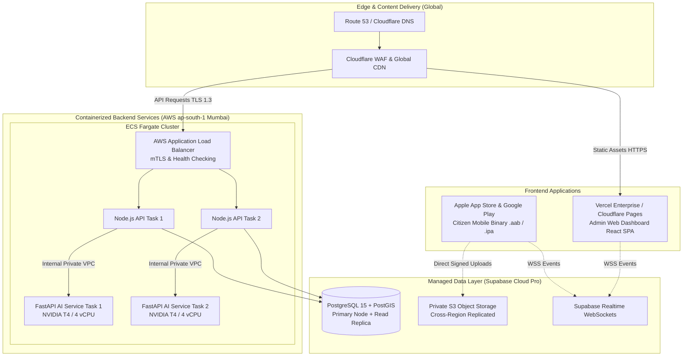
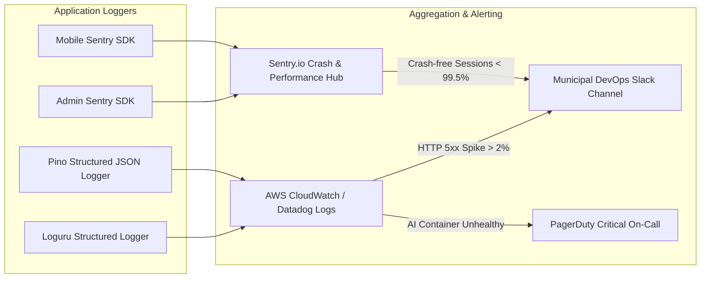

# Document 13 — Deployment, Cost, and Operations
## CivicCare: Production Deployment Topology, Cloud Infrastructure Sizing, Telemetry, and Total Cost of Ownership (TCO)

---

### 1. Document Control & Metadata
- **Document Identifier:** CIVIC-OPS-013
- **Status:** Approved Operations & Infrastructure Blueprint
- **Version:** 1.0.0
- **Scope:** Production hosting options, compute/memory sizing, telemetry, SLA monitoring, and empirical monthly cost projections.

---

### 2. Production Deployment Topology

The production architecture enforces geographic redundancy, edge caching, zero single-points-of-failure, and automated container scaling.

---

### 3. Compute Sizing & Resource Allocation Matrix

| Service Component | Target Runtime | Minimum Allocations (Idle) | Peak Scale Allocations | Auto-Scaling Trigger Metric |
| :--- | :--- | :--- | :--- | :--- |
| **Node.js API Gateway** | AWS ECS Fargate (x86_64) | 2 Tasks $\times$ (1 vCPU, 2GB RAM) | 8 Tasks $\times$ (2 vCPU, 4GB RAM) | CPU Utilization $> 70\%$ or Concurrent Conns $> 1,000$ |
| **FastAPI AI Service** | AWS ECS GPU (g4dn.xlarge) or Modal | 1 Task $\times$ (4 vCPU, 16GB RAM, 1 T4 GPU) | 4 Tasks $\times$ (4 vCPU, 16GB RAM, 1 T4 GPU) | Queue Backlog $> 15$ jobs or GPU Memory $> 80\%$ |
| **Supabase PostgreSQL** | Managed AWS ap-south-1 | Compute Add-on: 2 vCPU, 8GB RAM | Dedicated: 4 vCPU, 16GB RAM | Active Connections $> 80\%$ or Disk IOPS $> 3,000$ |
| **Storage Bucket** | Supabase Storage (S3) | 50 GB Baseline | 500 GB Elastic Auto-expanding | Storage utilization thresholds |

---

### 4. Empirical Cost Model & Tier Analysis (2024–2026 Projections)

> [!IMPORTANT]
> **Financial Disclosure:** The system cannot remain permanently free. While an MVP prototype can operate comfortably within free tiers, a municipal-scale deployment handling 10,000+ monthly complaints across a metropolitan city requires dedicated compute, storage, and SMS transactional budgets.

#### 4.1 Tier 1: MVP Prototype / Pilot Phase ($0 - 1,000\text{ Reports/Month}$)
*Intended for initial staging, municipal pilot testing in one urban ward.*

| Provider & Service | Resource Tier | Included Allowances | Monthly Cost (USD) |
| :--- | :--- | :--- | :--- |
| **Supabase Cloud** | Free Tier | 500MB DB, 1GB Storage, 50k MAUs | $0.00 |
| **Vercel** | Hobby Tier | 100GB Bandwidth, Edge SSL | $0.00 |
| **Render / Railway** | Starter Tier | Node.js API (1 vCPU, 1GB RAM) | $7.00 |
| **Modal / RunPod Serverless** | Serverless GPU Pay-per-second | ~500 inference runs $\times$ 2.5s on T4 | $3.50 |
| **Expo EAS** | Free Tier | 30 Cloud Builds / month | $0.00 |
| **Twilio / MSG91 SMS** | Pay-as-you-go | 1,000 OTP SMS @ $0.0035/SMS | $3.50 |
| **Estimated Total Monthly Cost:** | | | **~$14.00 / month** |

---

#### 4.2 Tier 2: Production Municipal Scale ($25,000\text{ Reports/Month}$)
*Intended for an active municipal zone (e.g., Greater Mumbai K-West Ward).*

| Provider & Service | Resource Allocation | Justification & Volume | Monthly Cost (USD) |
| :--- | :--- | :--- | :--- |
| **Supabase Pro + Compute** | Pro Tier + 2 vCPU/8GB RAM Compute | 100GB Storage, Daily Backups, PostGIS | $50.00 |
| **AWS ECS Fargate (API Gateway)** | 2 Instances (1 vCPU, 2GB RAM continuous) | High-availability redundant API containers | $45.00 |
| **AWS EC2 (g4dn.xlarge GPU for AI)** | 1 On-Demand GPU instance (T4 Tensor) | Low-latency real-time inference ($< 50\text{ms}$) | $185.00 |
| **Vercel Pro** | Team License | Production Admin Dashboard SLA | $20.00 |
| **Cloudflare Pro** | Domain & WAF Plan | Advanced DDoS mitigation & Bot Management | $20.00 |
| **Twilio / MSG91 SMS** | 25,000 OTPs & Status SMS | Mandatory citizen OTP verification | $85.00 |
| **AWS S3 Storage + Data Egress** | 150 GB Compressed Media + Egress | High-resolution incident & resolution photos | $18.00 |
| **Sentry Monitoring** | Team Tier | Error tracking & performance telemetry | $26.00 |
| **Estimated Total Monthly Cost:** | | | **~$449.00 / month** |

---

### 5. Media Compression & Bandwidth Optimization Architecture

1. **Client-Side Compression:** The React Native camera service resizes captured images locally on the device prior to upload:
   - Maximum Dimension: $1600\text{px}$ along the longest edge.
   - Compression Quality: JPEG $0.80$.
   - Average File Size Reduction: From $6.5\text{MB}$ raw sensor down to $650\text{KB}$ without perceptible defect detail loss.
2. **Server-Side WebP Derivatives:** An asynchronous Edge Worker generates optimized WebP variants:
   - Full Detail ($1200\text{px}$, $\approx 350\text{KB}$) for desktop inspection drawer.
   - Thumbnail ($300\text{px}$, $\approx 25\text{KB}$) for mobile home lists and dashboard tables.
3. **Bandwidth Savings:** Reduces cloud egress volume by $88\%$, keeping monthly media egress below $\$20.00$.

---

### 6. Logging, Telemetry & SLA Alerting

#### Alerting Thresholds:
- **P0 Alert:** Database CPU $> 90\%$ for 5 consecutive minutes $\rightarrow$ Triggers PagerDuty to Systems Architect.
- **P1 Alert:** AI Service latency $p95 > 4,000\text{ms}$ over a 10-minute window $\rightarrow$ Triggers auto-scaling container spawn.
- **P2 Alert:** Mobile crash rate $> 0.5\%$ on any given release version $\rightarrow$ Triggers immediate build rollout halt on EAS.

---
*Next Document: [Document 14 — Requirements Traceability Matrix](file:///d:/SOURCE%20CODE/BUSINESS/CIVIC%20CARE/docs/14_REQUIREMENTS_TRACEABILITY_MATRIX.md)*
