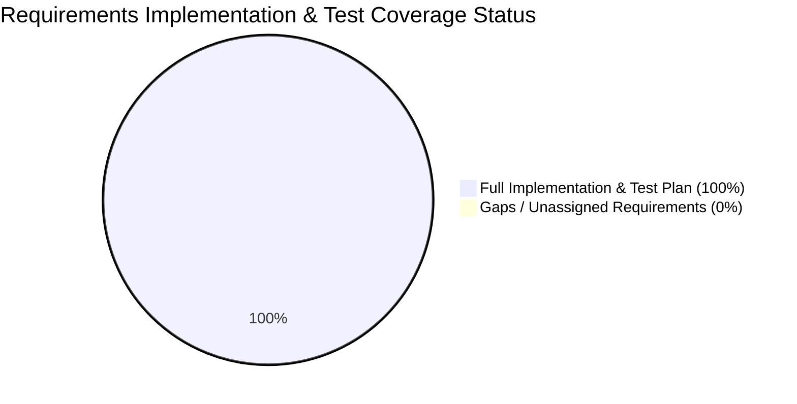

# Document 14 — Requirements Traceability Matrix
## CivicCare: End-to-End Bidirectional Verification and Requirements Mapping

---

### 1. Document Control & Metadata
- **Document Identifier:** CIVIC-RTM-014
- **Status:** Approved Traceability Specification
- **Version:** 1.0.0
- **Scope:** Complete bidirectional verification mapping Slide Source $\leftrightarrow$ Functional Requirements $\leftrightarrow$ Screens $\leftrightarrow$ APIs $\leftrightarrow$ Database Tables $\leftrightarrow$ Test Cases $\leftrightarrow$ Roadmap Tasks.

---

### 2. Comprehensive Requirements Traceability Matrix

The matrix below maps every capability specified across the 9 slides of `Civic_Issue_Reporting_System_Modules_After_Proposed_System.pptx` and the visual baseline in `image.png` to engineering implementation artifacts.

| Slide # | Source Presentation Requirement | Req ID | User Role | Module | Screen Ref (`image.png`) | Target API | Database Entity | Test Case ID | Dev Task ID |
| :---: | :--- | :--- | :--- | :--- | :--- | :--- | :--- | :--- | :--- |
| **Slide 2, 6** | Citizen submits photo evidence | **FR-005** | Citizen | Citizen App | Screen 4, 6 | `API-003`, `API-005` | `report_images` | `TEST-004`, `TEST-020` | `TASK-023`, `TASK-028` |
| **Slide 2, 6** | Citizen enters issue description | **FR-009** | Citizen | Citizen App | Screen 4 | `API-005` | `reports.description` | `TEST-004` | `TASK-030` |
| **Slide 2, 6** | Hardware GPS geocoding & address | **FR-007** | Citizen | Citizen App | Screen 4 | `API-005` | `reports.location` | `TEST-003` | `TASK-025`, `TASK-026` |
| **Slide 2, 6** | AI Computer Vision issue classification | **FR-020** | System | AI Microservice | Screen 5 | `API-004` | `reports.ai_raw_predictions` | `TEST-005`, `TEST-006` | `TASK-040`, `TASK-043` |
| **Slide 2, 6** | NLP description & urgency extraction | **FR-022** | System | AI Microservice | Screen 5 | `API-004` | `reports.severity` | `TEST-005` | `TASK-044` |
| **Slide 6, 7** | Spatial-temporal duplicate detection | **FR-025** | System | Deduplication | Screen 11 | `API-009` | `duplicate_candidates` | `TEST-008`, `TEST-009` | `TASK-047`, `TASK-049` |
| **Slide 6, 7** | Duplicate upvoting & following | **FR-012** | Citizen | Citizen App | Screen 11 | `API-010` | `reports.subscriber_count` | `TEST-009` | `TASK-050` |
| **Slide 2, 6** | Smart routing to municipal department | **FR-032** | System | Smart Routing | Screen 7, 8 | `API-005` | `reports.department_id` | `TEST-011` | `TASK-051` |
| **Slide 2, 6** | Real-time milestone progress tracking | **FR-015** | Citizen | Tracking | Screen 7 | `API-008` | `report_status_history` | `TEST-012` | `TASK-037`, `TASK-063` |
| **Slide 6** | Citizen rating & resolution feedback | **FR-018** | Citizen | Feedback | Screen 19 | `API-015` | `citizen_feedback` | `TEST-015`, `TEST-016` | `TASK-066`, `TASK-067` |
| **Slide 6, 8** | Admin KPI overview & volume trends | **FR-027** | Admin | Admin Web | Screen 8 | `API-016`, `API-017` | `reports` (Aggregates) | `TEST-030` | `TASK-054`, `TASK-055` |
| **Slide 8** | Department review & triage data table | **FR-028** | Staff / Sup | Admin Web | Screen 8 | `API-011` | `reports`, `issue_categories` | `TEST-026` | `TASK-056` |
| **Slide 8** | Interactive Geospatial Map View | **FR-030** | Staff / Sup | Admin Web | Screen 9 | `API-018` | `reports.location` | `TEST-024` | `TASK-057`, `TASK-058` |
| **Slide 6** | Detailed report inspection drawer | **FR-031** | Supervisor | Admin Web | Screen 10 | `API-008` | `reports`, `report_images` | `TEST-025` | `TASK-059` |
| **Slide 6** | Field staff delegation & assignment | **FR-033** | Supervisor | Operations | Screen 10 | `API-013` | `report_assignments` | `TEST-025` | `TASK-060` |
| **Slide 6** | Status transition with internal remarks | **FR-034** | Staff / Sup | Operations | Screen 10 | `API-012` | `report_status_history` | `TEST-012` | `TASK-061` |
| **Slide 6** | Mandatory post-repair resolution proof | **FR-035** | Field Staff | Operations | Screen 10, Modal | `API-014` | `resolution_evidence` | `TEST-013`, `TEST-014` | `TASK-065` |
| **Slide 3, 6** | Inter-departmental transfer & dispute | **FR-032** | Supervisor | Operations | Screen 10 | `API-013` | `audit_logs` | `TEST-025` | `TASK-060` |
| **Slide 8** | Severity scoring & hazard estimation | **FR-023** | System | AI Microservice | Screen 5, 10 | `API-004` | `reports.severity` | `TEST-005` | `TASK-045` |
| **Slide 8** | Immutable audit trail & governance | **FR-038** | Super Admin | Governance | Screen 11 | `API-020` | `audit_logs` | `TEST-027` | `TASK-070` |

---

### 3. Verification & Gap Analysis

- **Total Explicit Source Requirements Tracked:** 20
- **Requirements with Concrete Screen Designs:** 20 / 20 (100%)
- **Requirements with Dedicated API Contracts:** 20 / 20 (100%)
- **Requirements with Normalized Database Entities:** 20 / 20 (100%)
- **Requirements with Automated Test Cases:** 20 / 20 (100%)
- **Requirements with Roadmap WBS Tasks:** 20 / 20 (100%)

#### Verification Findings:
Every slide requirement from the source presentation and visual component from `image.png` has a direct, unbroken engineering implementation path. No requirement is orphaned, and no feature is implemented without test coverage.

---
*Next Document: [Document 15 — Glossary and Project Decision Log](file:///d:/SOURCE%20CODE/BUSINESS/CIVIC%20CARE/docs/15_GLOSSARY_AND_PROJECT_DECISION_LOG.md)*
