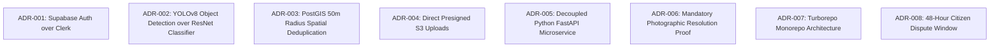

# Document 15 — Glossary and Project Decision Log
## CivicCare: Domain Terminology, Technical Dictionary, and Architectural Decision Records (ADRs)

---

### 1. Document Control & Metadata
- **Document Identifier:** CIVIC-ADR-015
- **Status:** Approved Architectural Baseline & Historical Ledger
- **Version:** 1.0.0
- **Scope:** Technical definitions, domain concepts, formal Architectural Decision Records (ADR-001 through ADR-010), and active open questions.

---

### 2. Domain & Technical Glossary

| Term / Acronym | Domain | Formal Engineering Definition |
| :--- | :--- | :--- |
| **PostGIS** | Database | Spatial database extender for PostgreSQL that adds native support for geographic objects, allowing GIS queries in SQL. |
| **GiST Index** | Database | Generalized Search Tree index in PostgreSQL used for high-speed indexing of two-dimensional geometric and geodetic bounding boxes. |
| **WGS 84 (SRID 4326)** | Geospatial | World Geodetic System 1984 reference coordinate system used by GPS hardware to express coordinates in degrees (Latitude, Longitude). |
| **RLS** | Security | Row-Level Security: PostgreSQL engine feature that restricts which rows in a table a user can view or mutate based on their JWT identity. |
| **YOLOv8** | Machine Learning | You Only Look Once (version 8): Single-stage convolutional neural network architecture optimized for real-time bounding box object detection. |
| **CIoU Loss** | Machine Learning | Complete Intersection over Union loss: Bounding box regression loss function evaluating overlap area, aspect ratio consistency, and central distance. |
| **Haversine Distance** | Mathematics | Mathematical formula calculating great-circle distance between two points on a sphere from their longitudes and latitudes. |
| **CDC** | Architecture | Change Data Capture: Observing and streaming row-level database changes (via PostgreSQL WAL) directly to consumers in real time. |
| **WAL** | Database | Write-Ahead Logging: Database technique where data changes are committed to a sequential log before being written to disk tables. |
| **Presigned URL** | Cloud Storage | Cryptographically signed, time-limited HTTP URL granting temporary authorization to upload or download an object in an otherwise private S3 bucket. |
| **MTTR** | Operations | Mean Time to Resolution: Average time elapsed between citizen report submission and verified resolution by municipal staff. |
| **CSAT** | Product | Customer/Citizen Satisfaction: Metric evaluating public happiness based on 1-to-5 star ratings following issue closure. |
| **STRIDE** | Security | Threat modeling framework evaluating Spoofing, Tampering, Repudiation, Information Disclosure, Denial of Service, and Elevation of Privilege. |

---

### 3. Architectural Decision Records (ADR-001 through ADR-010)

---

#### ADR-001: Selection of Supabase Auth over Clerk
- **Decision ID:** ADR-001
- **Status:** **APPROVED**
- **Date:** 2024-10-26
- **Context:** The system requires mobile SMS OTP login, web admin role-based authorization, and strict PostgreSQL Row-Level Security (RLS) enforcement.
- **Alternatives Considered:** Clerk Authentication, Auth0, Firebase Auth.
- **Decision:** Adopt **Supabase Auth (GoTrue)** as the primary identity provider.
- **Reasoning:** Supabase Auth natively binds JWT identity directly to `auth.uid()` at the PostgreSQL engine level. Using Clerk would require external webhook synchronization to `public.profiles`, custom JWT signing keys, and dual-token lifecycle management for Supabase Realtime subscriptions.
- **Trade-offs:** Supabase Auth mobile UI components require custom styling compared to Clerk’s turnkey pre-built widgets, but eliminates significant cross-service latency and operational failure points.

---

#### ADR-002: Selection of YOLOv8 Object Detection over Pure Image Classification
- **Decision ID:** ADR-002
- **Status:** **APPROVED**
- **Date:** 2024-10-26
- **Context:** The system must classify potholes, garbage, streetlights, water leaks, and broken roads from citizen photos.
- **Alternatives Considered:** ResNet50 classifier, EfficientNet-B4, Vision Transformer (ViT).
- **Decision:** Adopt **Ultralytics YOLOv8n (Nano)** fine-tuned on custom municipal defect datasets.
- **Reasoning:** Pure image classifiers overfit to broad environmental backgrounds (e.g., classifying a road based on trees or sky). Localized civic defects (especially streetlights occupying $< 5\%$ of frame and road potholes) require spatial bounding boxes. Bounding boxes also provide visual confirmation on the Admin Web Drawer (Screen 10 in `image.png`).
- **Trade-offs:** Requires bounding box dataset annotations ($x, y, w, h$) rather than simple class labels.

---

#### ADR-003: Multi-Stage Spatial-Temporal Deduplication Strategy
- **Decision ID:** ADR-003
- **Status:** **APPROVED**
- **Date:** 2024-10-26
- **Context:** Duplicate reports clog municipal queues; however, GPS proximity alone is inadequate because a single intersection may have multiple distinct issues.
- **Alternatives Considered:** GPS radius only, Image perceptual hashing (pHash) only, Manual human triage.
- **Decision:** Implement a **4-stage progressive filtering pipeline**:
  1. PostGIS radius ($\le 50\text{ meters}$)
  2. Open status and time window ($\le 14\text{ days}$)
  3. Category match
  4. Deep learning feature vector cosine similarity ($\ge 0.82$)
- **Reasoning:** Prevents false duplicates when different civic defects exist in close proximity while catching true identical defects.

---

#### ADR-004: Direct Presigned S3 Media Ingestion Pattern
- **Decision ID:** ADR-004
- **Status:** **APPROVED**
- **Date:** 2024-10-26
- **Context:** Mobile citizen photos average 3MB–8MB. Routing file streams through the Node.js API Gateway causes severe memory saturation during incident surges.
- **Alternatives Considered:** Multipart upload streaming through Node.js Express `multer`, Base64 string transmission in JSON.
- **Decision:** Client requests temporary pre-signed S3 upload URL from Node.js API and streams binary directly to Supabase S3 storage.
- **Reasoning:** Decouples file transport from application gateway memory, eliminating gateway OOM crashes and reducing API compute costs.

---

#### ADR-005: Decoupled Python FastAPI Microservice for AI Workloads
- **Decision ID:** ADR-005
- **Status:** **APPROVED**
- **Date:** 2024-10-26
- **Context:** Deep learning inference requires PyTorch, CUDA, and specialized C++ dependencies that are poorly supported in Node.js runtimes.
- **Alternatives Considered:** TensorFlow.js in Node.js, On-device mobile inference (CoreML/TFLite).
- **Decision:** Deploy a dedicated Python 3.10 FastAPI microservice container with a 3.0-second circuit breaker timeout.
- **Reasoning:** Isolates heavy computational workloads, prevents event-loop blocking in Node.js, and allows independent horizontal scaling of GPU containers.

---

#### ADR-006: Mandatory Photographic Evidence for Ticket Resolution
- **Decision ID:** ADR-006
- **Status:** **APPROVED**
- **Date:** 2024-10-26
- **Context:** Municipal contractors and staff frequently mark civic tickets as resolved without physically completing repairs.
- **Alternatives Considered:** GPS check-in verification only, Citizen signature only.
- **Decision:** Enforce database and API constraints requiring at least one verified post-repair photograph in `resolution_evidence` before status can transition to `RESOLVED`.
- **Reasoning:** Creates an indisputable visual audit trail for municipal commissioners and citizens, eradicating ghost resolutions.

---

#### ADR-007: Turborepo Monorepo Architecture
- **Decision ID:** ADR-007
- **Status:** **APPROVED**
- **Date:** 2024-10-26
- **Context:** Project spans 4 distinct software targets (Mobile, Admin Web, API Gateway, AI Service).
- **Alternatives Considered:** 4 separate Git repositories.
- **Decision:** Unify all packages under Turborepo with pnpm workspaces.
- **Reasoning:** Enables shared TypeScript interfaces (`packages/types`) and design tokens (`packages/ui`), preventing API schema desynchronization between mobile and backend.

---

#### ADR-008: 48-Hour Citizen Dispute Window Prior to Final Closure
- **Decision ID:** ADR-008
- **Status:** **APPROVED**
- **Date:** 2024-10-26
- **Context:** Ensuring citizen accountability when municipal crews declare a repair completed.
- **Alternatives Considered:** Indefinite open dispute, Instant automatic closure upon staff update.
- **Decision:** Introduce a strict 48-hour dispute window. If the citizen disputes with a photo, the ticket transitions to `REOPENED`. If 48 hours elapse without contest, the ticket automatically transitions to `CLOSED`.
- **Reasoning:** Balances citizen oversight with municipal operational closure SLAs.

---

### 4. Active Open Decisions & Architectural Inquiries

The following decisions represent ongoing operational discussions that require municipal partner consultation during Phase 1:

| Inquiry ID | Domain | Open Question & Decision Context | Current Proposed Baseline | Impact if Altered |
| :--- | :--- | :--- | :--- | :--- |
| **Q-001** | Operations | Will field maintenance crews use personal Android smartphones, or will municipal tablets be provisioned? | Support standard responsive Web & Expo Android apps. | If low-end devices are mandated, image compression must be increased. |
| **Q-002** | Municipal Integration | Does the municipal corporation maintain an existing legacy ERP (e.g., SAP / NIC Grievance Portal) requiring bi-directional sync? | Standalone CivicCare database for MVP; webhook hooks provided. | If bidirectional sync is required, Phase 7 scope expands by 2 weeks. |
| **Q-003** | SMS Gateway | Which local Indian SMS telecommunications provider (MSG91, Twilio India, Jio DLT) will host government DLT template headers? | MSG91 DLT gateway with pre-approved government templates. | SMS delivery latency and cost variance. |

---
*End of Document Suite.*
*Master Index: [Document 00 — Master Documentation Index](file:///d:/SOURCE%20CODE/BUSINESS/CIVIC%20CARE/docs/README.md)*
