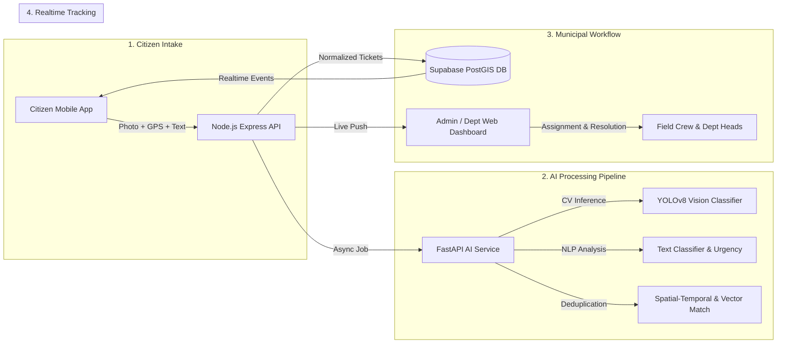

# CivicCare — AI-Powered Civic Issue Reporting & Resolution System
## Master Documentation Index & Implementation Blueprint

---

### Project Metadata
- **Project Name:** CivicCare
- **Codename:** CivicCare-Platform
- **Version:** 1.0.0 (Engineering Architecture & Specification Phase)
- **Status:** Architectural Design & Pre-Implementation Specification
- **Primary Source Documents:**
  - Presentation: `Civic_Issue_Reporting_System_Modules_After_Proposed_System.pptx` (9 Slides)
  - UI/UX Baseline Reference: `image.png` (Screens 1–7 Citizen App; Screens 8–9 + Details Drawer Admin Dashboard)
- **Target Platforms:**
  - Citizen Mobile Application: iOS & Android (React Native / Expo 51+ / TypeScript)
  - Municipal Admin Web Dashboard: Desktop & Tablet Web (React 18+ / Vite / Tailwind CSS / TypeScript)
  - Application API Service: Node.js 20 LTS / Express / TypeScript
  - AI Inference Engine: Python 3.10+ / FastAPI / OpenCV / PyTorch / Ultralytics YOLOv8
  - Data & Storage Layer: Supabase Managed PostgreSQL 15+ / PostGIS / Supabase Storage / Supabase Realtime

---

### Executive Summary

**CivicCare** is an end-to-end civic engagement and municipal automation ecosystem that bridges the chasm between urban residents and local municipal corporations. Built in response to the inefficiencies of legacy grievance helplines (paper registers, misrouted tickets, duplicate processing, and zero tracking), CivicCare introduces an automated intake, classification, deduplication, routing, and tracking lifecycle.

Through an intuitive mobile application, citizens photograph civic failures (e.g., hazardous potholes, uncollected garbage, defunct streetlights, bursting water mains), provide a brief natural language description, and automatically capture verified GPS coordinates. An asynchronous AI pipeline evaluates the visual and textual evidence, predicts the category and potential urgency level, screens for spatial-temporal duplicates, and auto-routes the verified ticket to the designated municipal department (e.g., Road Maintenance, Solid Waste, Public Lighting). Municipal officers and field supervisors manage resolution workflows on a responsive web dashboard equipped with live geospatial heatmaps, assignment routing, SLA tracking, and audit logging.

---

### Complete Documentation Map

The CivicCare engineering specification package is divided into 15 standalone, cross-referenced technical documents. Every document adheres to consistent system entities, schema definitions, status enumerations, API contracts, and security rules.

| Document Number & Title | File Reference | Primary Focus & Target Audience |
| :--- | :--- | :--- |
| **Document 01: Product Requirements Document (PRD)** | [01_PRODUCT_REQUIREMENTS_DOCUMENT.md](file:///d:/SOURCE%20CODE/BUSINESS/CIVIC%20CARE/docs/01_PRODUCT_REQUIREMENTS_DOCUMENT.md) | Product vision, user personas, functional requirements (FR-001–FR-050), non-functional requirements (NFR), MVP scope boundaries, and Definition of Done. |
| **Document 02: System Workflows & User Journeys** | [02_SYSTEM_WORKFLOWS_AND_USER_JOURNEYS.md](file:///d:/SOURCE%20CODE/BUSINESS/CIVIC%20CARE/docs/02_SYSTEM_WORKFLOWS_AND_USER_JOURNEYS.md) | End-to-end lifecycle flows, state transition machines, Mermaid sequence diagrams, offline handling, duplicate remediation, and error recovery. |
| **Document 03: UI/UX Design System & Screen Specs** | [03_UI_UX_DESIGN_SYSTEM_AND_SCREEN_SPECS.md](file:///d:/SOURCE%20CODE/BUSINESS/CIVIC%20CARE/docs/03_UI_UX_DESIGN_SYSTEM_AND_SCREEN_SPECS.md) | Design tokens, typography, component styling, comprehensive specifications for 19 Citizen Mobile screens and 11 Municipal Admin screens based on `image.png`. |
| **Document 04: Technical Architecture** | [04_TECHNICAL_ARCHITECTURE.md](file:///d:/SOURCE%20CODE/BUSINESS/CIVIC%20CARE/docs/04_TECHNICAL_ARCHITECTURE.md) | C4 architectural models, service boundary definitions, authentication comparison (Clerk vs. Supabase Auth), API gateways, and deployment topology. |
| **Document 05: Database Schema & Data Dictionary** | [05_DATABASE_SCHEMA_AND_DATA_DICTIONARY.md](file:///d:/SOURCE%20CODE/BUSINESS/CIVIC%20CARE/docs/05_DATABASE_SCHEMA_AND_DATA_DICTIONARY.md) | Complete PostgreSQL DDL with PostGIS geometries, Row-Level Security (RLS) policies, indexes, foreign keys, triggers, and data dictionaries. |
| **Document 06: API Specification** | [06_API_SPECIFICATION.md](file:///d:/SOURCE%20CODE/BUSINESS/CIVIC%20CARE/docs/06_API_SPECIFICATION.md) | RESTful API specifications with JSON schemas, bearer auth rules, rate limiting, request/response examples, and error codes (API-001–API-028). |
| **Document 07: AI/ML Design & Implementation** | [07_AI_ML_DESIGN_AND_IMPLEMENTATION.md](file:///d:/SOURCE%20CODE/BUSINESS/CIVIC%20CARE/docs/07_AI_ML_DESIGN_AND_IMPLEMENTATION.md) | Computer vision model selection (YOLOv8 vs. CNN), dataset curation, training pipeline, NLP classification, spatial-temporal duplicate algorithms, and fallback policies. |
| **Document 08: Use Cases & Business Rules** | [08_USE_CASES_AND_BUSINESS_RULES.md](file:///d:/SOURCE%20CODE/BUSINESS/CIVIC%20CARE/docs/08_USE_CASES_AND_BUSINESS_RULES.md) | Formal use cases (UC-001–UC-020), preconditions, main flows, alternative branches, exceptions, role authorization matrix, and validation rules. |
| **Document 09: Security, Privacy & Abuse Prevention** | [09_SECURITY_PRIVACY_AND_ABUSE_PREVENTION.md](file:///d:/SOURCE%20CODE/BUSINESS/CIVIC%20CARE/docs/09_SECURITY_PRIVACY_AND_ABUSE_PREVENTION.md) | EXIF stripping, signed URL media isolation, rate limiting, anti-tampering heuristics, audit logging, zero-trust RLS policies, and PII minimization. |
| **Document 10: Testing & Quality Assurance** | [10_TESTING_AND_QUALITY_ASSURANCE.md](file:///d:/SOURCE%20CODE/BUSINESS/CIVIC%20CARE/docs/10_TESTING_AND_QUALITY_ASSURANCE.md) | Test strategy, test matrix (TEST-001–TEST-035), AI validation benchmarks, network latency/offline simulation, security penetration tests, and quality gates. |
| **Document 11: Development Roadmap & Task Breakdown** | [11_DEVELOPMENT_ROADMAP_AND_TASK_BREAKDOWN.md](file:///d:/SOURCE%20CODE/BUSINESS/CIVIC%20CARE/docs/11_DEVELOPMENT_ROADMAP_AND_TASK_BREAKDOWN.md) | 10-Phase implementation plan, WBS task items (TASK-001–TASK-075), prerequisites, deliverables, risk mitigations, and phase definitions of done. |
| **Document 12: Repository Structure & Developer Setup** | [12_REPOSITORY_STRUCTURE_AND_DEVELOPER_SETUP.md](file:///d:/SOURCE%20CODE/BUSINESS/CIVIC%20CARE/docs/12_REPOSITORY_STRUCTURE_AND_DEVELOPER_SETUP.md) | Monorepo layout (Turborepo), directory structures, environment variable matrices, local Docker setup, linting/formatting rules, and CI/CD pipelines. |
| **Document 13: Deployment, Cost & Operations** | [13_DEPLOYMENT_COST_AND_OPERATIONS.md](file:///d:/SOURCE%20CODE/BUSINESS/CIVIC%20CARE/docs/13_DEPLOYMENT_COST_AND_OPERATIONS.md) | Hosting infrastructure (Vercel, Supabase, Render/AWS ECS), compute/storage sizing, caching, tier cost modeling, telemetry, and SLA alerting. |
| **Document 14: Requirements Traceability Matrix** | [14_REQUIREMENTS_TRACEABILITY_MATRIX.md](file:///d:/SOURCE%20CODE/BUSINESS/CIVIC%20CARE/docs/14_REQUIREMENTS_TRACEABILITY_MATRIX.md) | Bidirectional mapping from slide requirements to FRs, screens, database tables, APIs, tests, and roadmap task milestones. |
| **Document 15: Glossary & Project Decision Log** | [15_GLOSSARY_AND_PROJECT_DECISION_LOG.md](file:///d:/SOURCE%20CODE/BUSINESS/CIVIC%20CARE/docs/15_GLOSSARY_AND_PROJECT_DECISION_LOG.md) | Formal domain terminology definitions, architectural decision records (ADR-001–ADR-012) with rationale, rejected alternatives, and trade-offs. |

---

### Cross-System Standard Enumerations

All specifications, database tables, APIs, and UI states strictly abide by the following enumerations:

#### 1. Issue Categories (`issue_category_enum`)
- `POTHOLE`: Road surface cavities, asphalt depressions, and rim-damaging craters.
- `GARBAGE`: Overflowing street bins, unattended dumps, biological or organic waste piles.
- `STREETLIGHT`: Defunct luminaires, flickering bulbs, damaged light poles, exposed junction wiring.
- `WATER_LEAK`: Burst utility mains, leaking public valves, localized clean water flooding.
- `BROKEN_ROAD`: Severe structural road cracks, eroded shoulders, caved-in culverts, missing manhole covers.
- `OTHERS`: Civic hazards not fitting standard classes (fallen trees, damaged bus stops, vandalized public property).

#### 2. Report Statuses (`report_status_enum`)
- `SUBMITTED`: Report lodged by citizen; stored in database; awaiting processing.
- `AI_VERIFIED`: Visual/textual AI models evaluated report, predicted category and severity.
- `ROUTED`: Dispatched to specific municipal department based on category and jurisdiction.
- `ASSIGNED`: Department supervisor has designated an individual field worker or crew.
- `IN_PROGRESS`: Remediation crew has mobilized to site; work actively underway.
- `RESOLVED`: Remediation completed; post-repair photographic evidence uploaded.
- `CLOSED`: Verified by municipal administrator or confirmed by citizen feedback.
- `REJECTED`: Declared non-civic, out of jurisdiction, inappropriate, or unserviceable.
- `DUPLICATE`: Flagged as an exact duplicate of an existing active incident; linked as child ticket.
- `REOPENED`: Citizen contested resolution within 48 hours with photographic counter-evidence.

#### 3. Severity Levels (`severity_level_enum`)
- `LOW`: Aesthetic or minor civic deficiency with negligible public hazard (e.g., minor pavement discoloration).
- `MEDIUM`: Nuisance or degrading infrastructure requiring scheduled repair (e.g., small pothole on side alley).
- `HIGH`: Active vehicular or pedestrian safety hazard (e.g., deep pothole on arterial road, blackout on major intersection).
- `CRITICAL`: Immediate mortal hazard or catastrophic failure (e.g., open deep manhole, sparking live wire in water).

#### 4. User Roles (`user_role_enum`)
- `CITIZEN`: Registered or verified resident creating tickets and tracking their own submissions.
- `FIELD_WORKER`: Municipal operational staff viewing assigned tasks and uploading resolution evidence.
- `DEPT_SUPERVISOR`: Department administrator managing category queues, reassigning staff, and approving closures.
- `SUPER_ADMIN`: Central municipal authority managing departments, cross-city analytics, system configuration, and audits.

---

### Source-of-Truth Classification

| Presentation Element | Status in Specification | Engineering Treatment |
| :--- | :--- | :--- |
| **Citizen Intake (Photo, GPS, Text)** | **Core Baseline Requirement** | Fully detailed in PRD, Screens 4, 6, DB `reports`, API-004. |
| **AI Classification (CNN + NLP)** | **Core Baseline Requirement** | Implemented as fine-tuned YOLOv8 + DistilBERT/Text-Embeddings in separate Python service. |
| **Duplicate Detection** | **Core Baseline Requirement** | Spatial-temporal filtering (PostGIS) + Cosine similarity on image embeddings. |
| **Smart Department Routing** | **Core Baseline Requirement** | Deterministic rule engine routing by category & municipal boundary geo-fencing. |
| **Realtime Tracking & Feedback** | **Core Baseline Requirement** | Supabase Realtime subscriptions + Push Notifications via Expo. |
| **Severity Scoring** | **Proposed Implementation Design** | Hybrid model: AI proposed score confirmed/overridden by supervisor or user. |
| **Duplicate / Fake Detection** | **Proposed Implementation Design** | Near-duplicate detection included; Deepfake/AI image synthesis detection marked as future research. |
| **Multilingual Support / Chatbot** | **Optional Future Enhancement** | Architectural hooks designed; localized strings in i18n; NLP fine-tuning scheduled for Phase 9. |
| **City-Wide Analytics** | **Core Baseline Requirement** | High-level heatmaps & charts specified for admin web dashboard based on Screen 8/9. |

---
*Created as part of the CivicCare Architectural Specification Package.*
